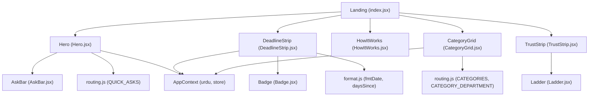
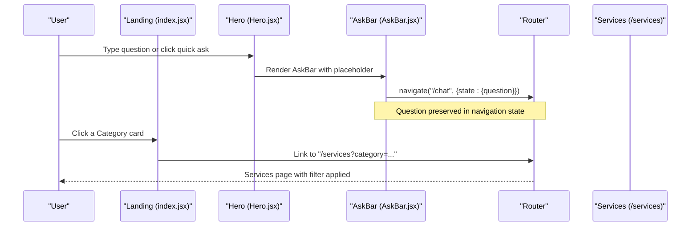
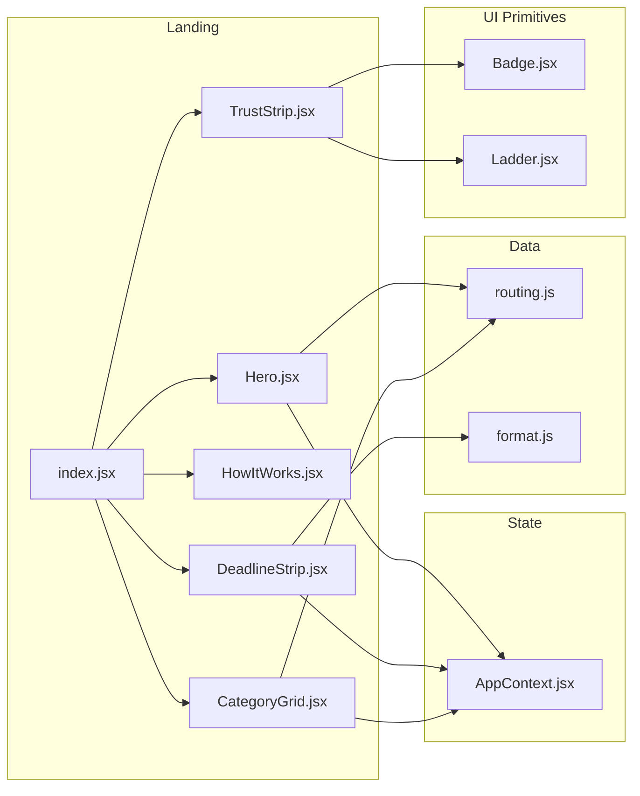

# Landing Page

<cite>
**Referenced Files in This Document**
- [index.jsx](file://src/pages/student/Landing/index.jsx)
- [Hero.jsx](file://src/pages/student/Landing/Hero.jsx)
- [DeadlineStrip.jsx](file://src/pages/student/Landing/DeadlineStrip.jsx)
- [HowItWorks.jsx](file://src/pages/student/Landing/HowItWorks.jsx)
- [CategoryGrid.jsx](file://src/pages/student/Landing/CategoryGrid.jsx)
- [TrustStrip.jsx](file://src/pages/student/Landing/TrustStrip.jsx)
- [AskBar.jsx](file://src/components/student/AskBar.jsx)
- [routing.js](file://src/mocks/routing.js)
- [AppContext.jsx](file://src/context/AppContext.jsx)
- [format.js](file://src/lib/format.js)
- [Badge.jsx](file://src/components/ui/Badge.jsx)
- [Ladder.jsx](file://src/components/ui/Ladder.jsx)
- [student.css](file://src/styles/student.css)
</cite>

## Table of Contents
1. Introduction
2. Project Structure
3. Core Components
4. Architecture Overview
5. Detailed Component Analysis
6. Dependency Analysis
7. Performance Considerations
8. Troubleshooting Guide
9. Conclusion

## Introduction
This document explains the student landing page that guides a new visitor from first impression to engagement with the AI assistant. It covers:
- Hero section with chat entry point
- DeadlineStrip for upcoming academic deadlines
- HowItWorks explanation of routing, lookup, and escalation
- CategoryGrid for browsing services by department
- TrustStrip demonstrating answer accountability with sources and freshness

The page is intentionally ordered to prioritize immediate needs (a place to ask), urgency (deadlines), clarity (how it works), discovery (categories), and trust (evidence).

## Project Structure
The landing page is composed of focused sub-components under a single page container. The container composes them in an intentional order to optimize conversion and reduce cognitive load.

**Diagram sources**
- [index.jsx:1-25](file://src/pages/student/Landing/index.jsx#L1-L25)
- [Hero.jsx:1-40](file://src/pages/student/Landing/Hero.jsx#L1-L40)
- [DeadlineStrip.jsx:1-72](file://src/pages/student/Landing/DeadlineStrip.jsx#L1-L72)
- [HowItWorks.jsx:1-55](file://src/pages/student/Landing/HowItWorks.jsx#L1-L55)
- [CategoryGrid.jsx:1-60](file://src/pages/student/Landing/CategoryGrid.jsx#L1-L60)
- [TrustStrip.jsx:1-59](file://src/pages/student/Landing/TrustStrip.jsx#L1-L59)
- [AskBar.jsx:1-41](file://src/components/student/AskBar.jsx#L1-L41)
- [routing.js:1-77](file://src/mocks/routing.js#L1-L77)
- [format.js:1-32](file://src/lib/format.js#L1-L32)
- [Badge.jsx:1-12](file://src/components/ui/Badge.jsx#L1-L12)
- [Ladder.jsx:1-32](file://src/components/ui/Ladder.jsx#L1-L32)
- [AppContext.jsx:1-135](file://src/context/AppContext.jsx#L1-L135)

**Section sources**
- [index.jsx:7-24](file://src/pages/student/Landing/index.jsx#L7-L24)

## Core Components
- Landing (index.jsx): Composes the visible sections in priority order: Hero → Deadlines → HowItWorks → Categories → Trust.
- Hero: Presents the value proposition, supports Urdu/Roman Urdu/English, embeds AskBar, and offers quick-start questions that navigate to /chat with the question pre-filled.
- DeadlineStrip: Shows upcoming deadlines sorted by date, with a “days remaining” badge and a link to Services.
- HowItWorks: Explains the three-step model: route, look up, or escalate to a person.
- CategoryGrid: Displays departments as cards with service counts and links to filtered Services.
- TrustStrip: Demonstrates transparency with a sample Q&A, routing confidence, tool call, source badge, and freshness ladder.

**Section sources**
- [index.jsx:14-23](file://src/pages/student/Landing/index.jsx#L14-L23)
- [Hero.jsx:6-39](file://src/pages/student/Landing/Hero.jsx#L6-L39)
- [DeadlineStrip.jsx:12-71](file://src/pages/student/Landing/DeadlineStrip.jsx#L12-L71)
- [HowItWorks.jsx:10-54](file://src/pages/student/Landing/HowItWorks.jsx#L10-L54)
- [CategoryGrid.jsx:21-59](file://src/pages/student/Landing/CategoryGrid.jsx#L21-L59)
- [TrustStrip.jsx:12-58](file://src/pages/student/Landing/TrustStrip.jsx#L12-L58)

## Architecture Overview
The landing page is a presentational layer driven by shared state and utilities:
- State: AppContext provides store (services, deadlines, departments), language toggle (urdu), and mutation helpers.
- Data sources: routing.js defines categories, quick asks, and category-to-department mapping; format.js provides date formatting and day calculations.
- UI primitives: Badge and Ladder provide consistent status and freshness indicators.
- Navigation: React Router’s useNavigate moves users to /chat with the question in navigation state.

**Diagram sources**
- [Hero.jsx:25-35](file://src/pages/student/Landing/Hero.jsx#L25-L35)
- [AskBar.jsx:15-19](file://src/components/student/AskBar.jsx#L15-L19)
- [CategoryGrid.jsx:35-53](file://src/pages/student/Landing/CategoryGrid.jsx#L35-L53)

## Detailed Component Analysis

### Hero Section
Purpose: Immediate engagement via natural-language query, with quick-start prompts to lower friction.

Key behaviors:
- Renders bilingual headline and description based on urdu flag from AppContext.
- Embeds AskBar for free-form queries.
- Displays top quick asks from routing.js and navigates to /chat with the selected question in navigation state.

Interactions:
- AskBar submits via Enter or button click, navigating to /chat with the question.
- Quick ask chips navigate to /chat with the same pattern.

Accessibility:
- AskBar input has aria-label for screen readers.
- Buttons are semantic and keyboard-accessible.

Responsive design:
- Centered layout with constrained max-width for readability.
- Chips wrap gracefully on small screens.

Implementation details:
- Uses useNavigate for client-side routing.
- Reads QUICK_ASKS from routing.js.
- Applies Urdu text direction when needed.

**Section sources**
- [Hero.jsx:6-39](file://src/pages/student/Landing/Hero.jsx#L6-L39)
- [AskBar.jsx:10-39](file://src/components/student/AskBar.jsx#L10-L39)
- [routing.js:67-76](file://src/mocks/routing.js#L67-L76)
- [student.css:113-214](file://src/styles/student.css#L113-L214)

### DeadlineStrip
Purpose: Surface time-sensitive information students care about most—upcoming deadlines.

Key behaviors:
- Filters deadlines where daysSince(date) < 0 (future dates).
- Sorts by ascending date and shows the next four items.
- Computes days remaining and renders a tone-aware badge (amber if ≤ 21 days, jade otherwise).
- Links to /services for full listing.

Data flow:
- Reads store.deadlines from AppContext.
- Formats dates using fmtDate and computes deltas with daysSince.

Accessibility:
- Semantic headings and list-like structure.
- Badge conveys urgency visually and numerically.

Responsive design:
- Two-column grid on medium+ screens, single column on small screens.

Performance:
- Filtering and sorting run on render; data set is small in mock context.

**Section sources**
- [DeadlineStrip.jsx:12-71](file://src/pages/student/Landing/DeadlineStrip.jsx#L12-L71)
- [format.js:3-14](file://src/lib/format.js#L3-L14)
- [AppContext.jsx:39-47](file://src/context/AppContext.jsx#L39-L47)
- [student.css:217-228](file://src/styles/student.css#L217-L228)

### HowItWorks
Purpose: Explain the system’s trust model without jargon: route, look up, or hand off to a person.

Key behaviors:
- Static steps array with icons, titles, and bodies.
- Renders a numbered step indicator per item.

Design:
- Three-column grid on large screens, fewer columns on smaller screens.
- Clear hierarchy with eyebrow, heading, and lede.

Accessibility:
- Semantic headings and paragraphs.
- Icons are decorative; meaning conveyed by text.

**Section sources**
- [HowItWorks.jsx:10-54](file://src/pages/student/Landing/HowItWorks.jsx#L10-L54)
- [student.css:277-289](file://src/styles/student.css#L277-L289)

### CategoryGrid
Purpose: Help students who don’t know how to phrase a question find services by department.

Key behaviors:
- Maps category IDs to icons.
- Counts services per category from store.services.
- Resolves department name via CATEGORY_DEPARTMENT mapping and store.departments.
- Links to /services with a URL-encoded category query parameter.

Localization:
- Displays English or Urdu labels and blurbs based on urdu flag.

Accessibility:
- Cards are links with clear titles and metadata.

Responsive design:
- Grid adapts from one to two to three columns based on breakpoints.

**Section sources**
- [CategoryGrid.jsx:8-59](file://src/pages/student/Landing/CategoryGrid.jsx#L8-L59)
- [routing.js:11-64](file://src/mocks/routing.js#L11-L64)
- [AppContext.jsx:39-47](file://src/context/AppContext.jsx#L39-L47)
- [student.css:217-228](file://src/styles/student.css#L217-L228)

### TrustStrip
Purpose: Demonstrate transparency and accountability through a realistic example.

Key behaviors:
- Shows a sample question, routing result with confidence, answer text, tool call, source badge, and freshness ladder.
- Uses Badge for source identity and Ladder to visualize verification recency.

Visual cues:
- Route chip indicates matched department and confidence.
- Tool call displays function name and parameters with source reference.
- Freshness ladder communicates staleness risk.

Accessibility:
- Ladder includes aria-label describing verification age.
- Source badge uses semantic elements.

**Section sources**
- [TrustStrip.jsx:12-58](file://src/pages/student/Landing/TrustStrip.jsx#L12-L58)
- [Badge.jsx:5-10](file://src/components/ui/Badge.jsx#L5-L10)
- [Ladder.jsx:10-31](file://src/components/ui/Ladder.jsx#L10-L31)

## Dependency Analysis
The landing components depend on shared state, utilities, and UI primitives:

**Diagram sources**
- [index.jsx:1-25](file://src/pages/student/Landing/index.jsx#L1-L25)
- [Hero.jsx:1-40](file://src/pages/student/Landing/Hero.jsx#L1-L40)
- [DeadlineStrip.jsx:1-72](file://src/pages/student/Landing/DeadlineStrip.jsx#L1-L72)
- [HowItWorks.jsx:1-55](file://src/pages/student/Landing/HowItWorks.jsx#L1-L55)
- [CategoryGrid.jsx:1-60](file://src/pages/student/Landing/CategoryGrid.jsx#L1-L60)
- [TrustStrip.jsx:1-59](file://src/pages/student/Landing/TrustStrip.jsx#L1-L59)
- [AppContext.jsx:1-135](file://src/context/AppContext.jsx#L1-L135)
- [routing.js:1-77](file://src/mocks/routing.js#L1-L77)
- [format.js:1-32](file://src/lib/format.js#L1-L32)
- [Badge.jsx:1-12](file://src/components/ui/Badge.jsx#L1-L12)
- [Ladder.jsx:1-32](file://src/components/ui/Ladder.jsx#L1-L32)

**Section sources**
- [AppContext.jsx:39-47](file://src/context/AppContext.jsx#L39-L47)
- [routing.js:11-76](file://src/mocks/routing.js#L11-L76)
- [format.js:3-14](file://src/lib/format.js#L3-L14)

## Performance Considerations
- Rendering cost: All computations are lightweight (filter/sort on small arrays). If deadlines/services grow, consider memoization or virtualization at the list level.
- Re-renders: Components read from AppContext; changes to store will trigger re-renders across consumers. Keep store updates targeted.
- Navigation: Client-side routing via React Router avoids server round-trips for landing interactions.
- Styling: CSS uses responsive grids and minimal transforms; avoid heavy animations on low-power devices.

[No sources needed since this section provides general guidance]

## Troubleshooting Guide
Common issues and checks:
- No deadlines shown: Ensure store.deadlines contains future dates and daysSince correctly identifies them. Verify TODAY constant alignment with mock data.
- Wrong category count: Confirm store.services.cat values match category IDs and CATEGORY_DEPARTMENT mapping exists.
- Language not switching: Check urdu flag in AppContext and ensure conditional rendering paths are used consistently.
- Navigation state lost: When navigating to /chat, confirm state.question is passed and consumed by the Chat page.
- Accessibility gaps: Ensure all interactive elements have appropriate labels and roles; verify focus states in AskBar and buttons.

**Section sources**
- [DeadlineStrip.jsx:15-20](file://src/pages/student/Landing/DeadlineStrip.jsx#L15-L20)
- [CategoryGrid.jsx:35-53](file://src/pages/student/Landing/CategoryGrid.jsx#L35-L53)
- [AskBar.jsx:15-19](file://src/components/student/AskBar.jsx#L15-L19)
- [AppContext.jsx:35-47](file://src/context/AppContext.jsx#L35-L47)

## Conclusion
The landing page prioritizes user goals: ask quickly, see urgent deadlines, understand how answers are produced, discover relevant services, and verify trust through evidence. Its modular components rely on shared state and utilities to keep behavior consistent and maintainable. Responsive grids and accessible patterns ensure usability across devices and assistive technologies.

[No sources needed since this section summarizes without analyzing specific files]