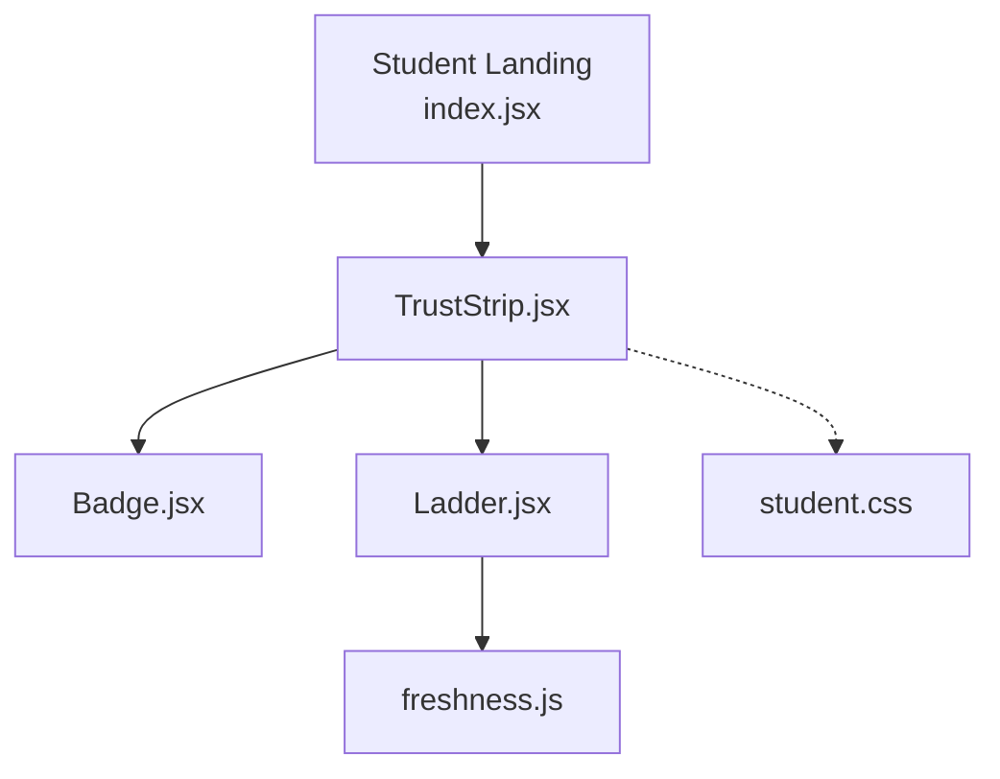
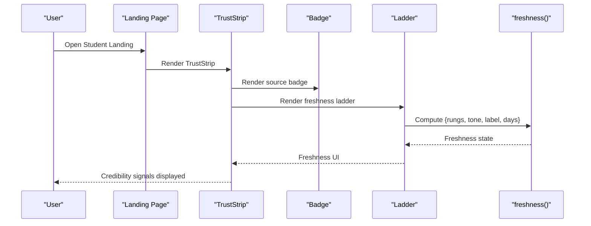
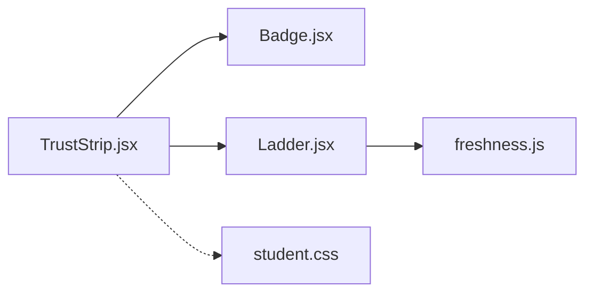

# Trust Strip

<cite>
**Referenced Files in This Document**
- [TrustStrip.jsx](file://src/pages/student/Landing/TrustStrip.jsx)
- [index.jsx](file://src/pages/student/Landing/index.jsx)
- [Badge.jsx](file://src/components/ui/Badge.jsx)
- [Ladder.jsx](file://src/components/ui/Ladder.jsx)
- [freshness.js](file://src/lib/freshness.js)
- [student.css](file://src/styles/student.css)
</cite>

## Table of Contents
1. [Introduction](#introduction)
2. [Project Structure](#project-structure)
3. [Core Components](#core-components)
4. [Architecture Overview](#architecture-overview)
5. [Detailed Component Analysis](#detailed-component-analysis)
6. [Dependency Analysis](#dependency-analysis)
7. [Performance Considerations](#performance-considerations)
8. [Troubleshooting Guide](#troubleshooting-guide)
9. [Conclusion](#conclusion)

## Introduction
The Trust Strip is a student-facing landing section that demonstrates how the assistant builds trust by showing verifiable, source-backed answers. It communicates credibility through:
- Clear routing and match confidence for the selected department
- A concrete example answer with tool usage details
- Source citation and human verification freshness indicators
- Consistent visual language that signals reliability at a glance

This component does not fetch live data; it renders a realistic sample to persuade users that every answer can be checked against official records and shows when information was last verified.

## Project Structure
The Trust Strip lives within the Student Landing page and composes smaller UI primitives to present trust signals cohesively.

**Diagram sources**
- [index.jsx:1-25](file://src/pages/student/Landing/index.jsx#L1-L25)
- [TrustStrip.jsx:1-59](file://src/pages/student/Landing/TrustStrip.jsx#L1-L59)
- [Badge.jsx:1-12](file://src/components/ui/Badge.jsx#L1-L12)
- [Ladder.jsx:1-32](file://src/components/ui/Ladder.jsx#L1-L32)
- [freshness.js:1-37](file://src/lib/freshness.js#L1-L37)
- [student.css:80-450](file://src/styles/student.css#L80-L450)

**Section sources**
- [index.jsx:1-25](file://src/pages/student/Landing/index.jsx#L1-L25)
- [TrustStrip.jsx:1-59](file://src/pages/student/Landing/TrustStrip.jsx#L1-L59)

## Core Components
- TrustStrip: Renders the persuasive “receipts” section with a sample question, routing info, answer text, tool call detail, and source + freshness metadata.
- Badge: Displays a small status pill used to highlight the source document (e.g., fee circular).
- Ladder: Visualizes freshness based on the last human verification date using a four-rung indicator with tone and label.
- freshness: Computes freshness state from an ISO date string, returning rungs, tone, label, and days since verification.

Key trust signals presented:
- Routing and confidence: Shows which department the query was routed to and a match percentage.
- Tool transparency: Displays the exact tool invocation and parameters used to retrieve the answer.
- Source citation: Names the authoritative record (e.g., fee circular section).
- Verification freshness: Indicates how recently a staff member confirmed the data, with clear aging cues.

**Section sources**
- [TrustStrip.jsx:1-59](file://src/pages/student/Landing/TrustStrip.jsx#L1-L59)
- [Badge.jsx:1-12](file://src/components/ui/Badge.jsx#L1-L12)
- [Ladder.jsx:1-32](file://src/components/ui/Ladder.jsx#L1-L32)
- [freshness.js:1-37](file://src/lib/freshness.js#L1-L37)

## Architecture Overview
The Trust Strip is a static demonstration component embedded in the Student Landing page. It composes reusable UI elements to communicate system reliability without making network calls. The visual hierarchy emphasizes:
- Why you can check it (eyebrow and headline)
- A realistic Q&A flow with routing and confidence
- The tool call that produced the answer
- The source badge and freshness ladder indicating verification recency

**Diagram sources**
- [index.jsx:1-25](file://src/pages/student/Landing/index.jsx#L1-L25)
- [TrustStrip.jsx:1-59](file://src/pages/student/Landing/TrustStrip.jsx#L1-L59)
- [Badge.jsx:1-12](file://src/components/ui/Badge.jsx#L1-L12)
- [Ladder.jsx:1-32](file://src/components/ui/Ladder.jsx#L1-L32)
- [freshness.js:1-37](file://src/lib/freshness.js#L1-L37)

## Detailed Component Analysis

### TrustStrip
Purpose:
- Demonstrate accountability by showing a complete answer with receipts.
- Communicate routing accuracy and confidence.
- Expose tool usage and source provenance.
- Show verification freshness to reinforce reliability.

Structure:
- Left column: Eyebrow, headline, and lede explaining why answers are verifiable.
- Right column: Sample Q, routing card with confidence, answer text, tool call block, and source + freshness row.

Implementation notes:
- Uses semantic layout classes for spacing and grid alignment.
- Integrates icons for tool calls and verification badges.
- Leverages Badge and Ladder for consistent visual semantics across the app.

Accessibility and UX:
- Clear hierarchy with eyebrow, heading, and supporting copy.
- Compact but readable typography for dense metadata.
- Visual cues (colors, badges, ladder) convey status quickly.

**Section sources**
- [TrustStrip.jsx:1-59](file://src/pages/student/Landing/TrustStrip.jsx#L1-L59)
- [student.css:80-450](file://src/styles/student.css#L80-L450)

### Badge
Purpose:
- Render a small status pill with a tone to indicate verification or source type.

Behavior:
- Accepts a tone prop that maps to semantic color tokens.
- Wraps children in a span with a base class plus tone modifier.

Usage in Trust Strip:
- Highlights the source document name (e.g., fee circular reference).

**Section sources**
- [Badge.jsx:1-12](file://src/components/ui/Badge.jsx#L1-L12)

### Ladder
Purpose:
- Visualize freshness of a record based on the last human verification date.

Behavior:
- Computes freshness state via freshness utility.
- Renders four rungs colored according to age thresholds.
- Optionally displays numeric days or “today”.

Integration:
- Used under the source line to show recency of verification.

**Section sources**
- [Ladder.jsx:1-32](file://src/components/ui/Ladder.jsx#L1-L32)
- [freshness.js:1-37](file://src/lib/freshness.js#L1-L37)

### Freshness Logic
Purpose:
- Translate a verification date into a standardized freshness state.

Rules:
- 0–30 days: Four rungs, jade tone, labeled “Verified”.
- 31–90 days: Three rungs, jade tone, labeled “Verified”.
- 91–180 days: Two rungs, amber tone, labeled “Ageing”.
- 181+ days: One rung, rose tone, labeled “Stale”.

Output:
- Object containing rungs count, tone, label, and days since verification.

Complexity:
- O(1) time and space per computation.

**Section sources**
- [freshness.js:1-37](file://src/lib/freshness.js#L1-L37)

### Styling and Layout
- Section wrapper and grid provide responsive two-column layout on larger screens.
- Sample answer box uses a panel style with subtle borders and shadows.
- Routing card highlights department and confidence with distinct colors.
- Source row aligns badge, ladder, and date text consistently.

**Section sources**
- [student.css:80-450](file://src/styles/student.css#L80-L450)

## Dependency Analysis
TrustStrip depends on:
- Badge for source indication
- Ladder for freshness visualization
- freshness utility for computing verification state
- CSS classes for layout and visual semantics

**Diagram sources**
- [TrustStrip.jsx:1-59](file://src/pages/student/Landing/TrustStrip.jsx#L1-L59)
- [Badge.jsx:1-12](file://src/components/ui/Badge.jsx#L1-L12)
- [Ladder.jsx:1-32](file://src/components/ui/Ladder.jsx#L1-L32)
- [freshness.js:1-37](file://src/lib/freshness.js#L1-L37)
- [student.css:80-450](file://src/styles/student.css#L80-L450)

**Section sources**
- [TrustStrip.jsx:1-59](file://src/pages/student/Landing/TrustStrip.jsx#L1-L59)
- [Ladder.jsx:1-32](file://src/components/ui/Ladder.jsx#L1-L32)
- [freshness.js:1-37](file://src/lib/freshness.js#L1-L37)

## Performance Considerations
- Static rendering: No network requests; minimal DOM updates.
- Lightweight utilities: Freshness calculation is constant-time.
- Reusable components: Badge and Ladder avoid duplication and keep bundle size low.
- CSS-driven visuals: Most styling is declarative, reducing runtime overhead.

[No sources needed since this section provides general guidance]

## Troubleshooting Guide
Common issues and resolutions:
- Freshness not updating: Ensure the verified date passed to Ladder is a valid ISO string; freshness relies on correct date parsing.
- Missing visual cues: Verify that CSS classes for st-section, st-grid, st-sample, st-route, st-source are present and unmodified.
- Badge tone mismatch: Confirm the tone prop matches expected semantic tokens; incorrect values may render without intended emphasis.
- Accessibility: Ensure aria-labels and titles on freshness indicators remain intact for screen readers.

**Section sources**
- [Ladder.jsx:1-32](file://src/components/ui/Ladder.jsx#L1-L32)
- [freshness.js:1-37](file://src/lib/freshness.js#L1-L37)
- [student.css:80-450](file://src/styles/student.css#L80-L450)

## Conclusion
The Trust Strip effectively communicates system reliability by demonstrating transparent, source-backed answers with clear routing, tool usage, and verification freshness. Its composition of small, reusable components ensures consistency and maintainability while optimizing user perception through concise, credible signals.

[No sources needed since this section summarizes without analyzing specific files]