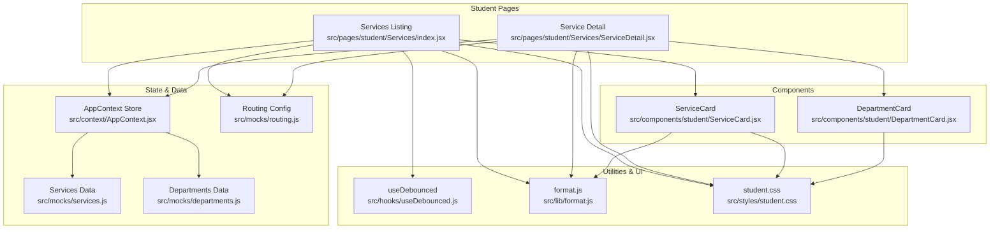
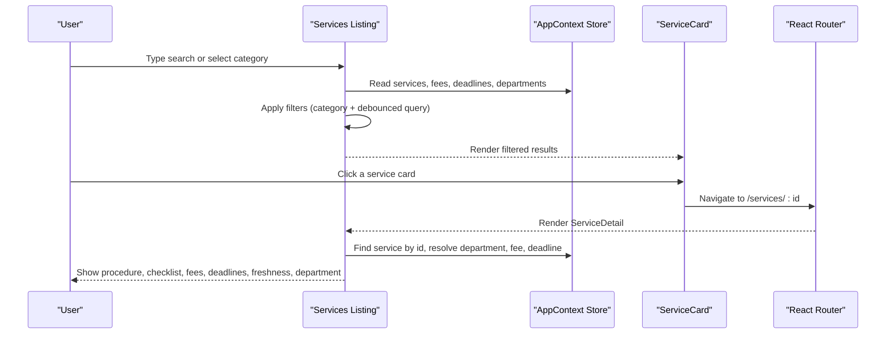
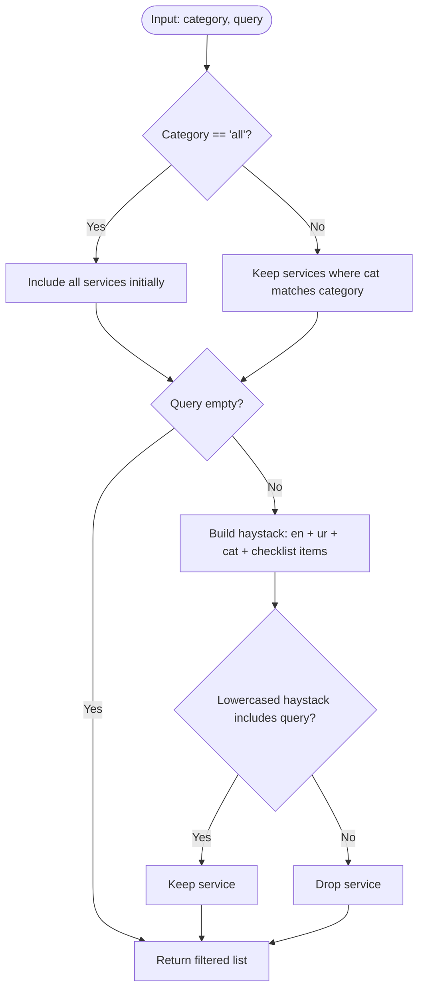
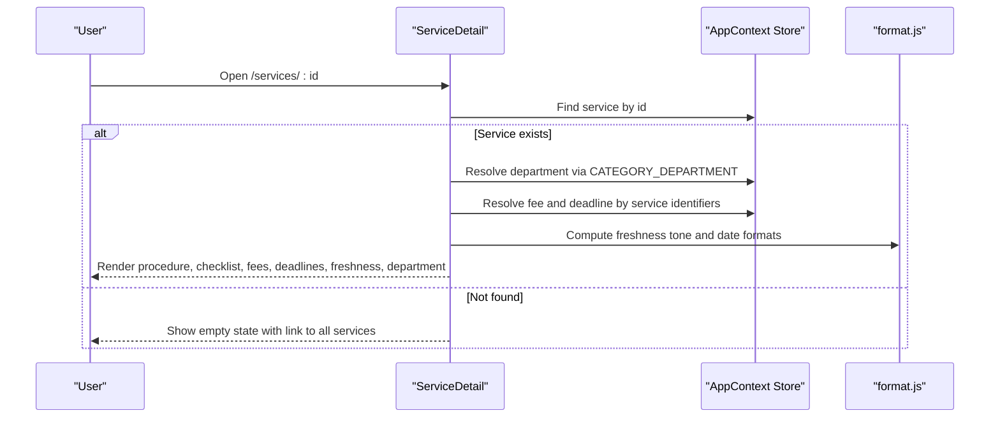
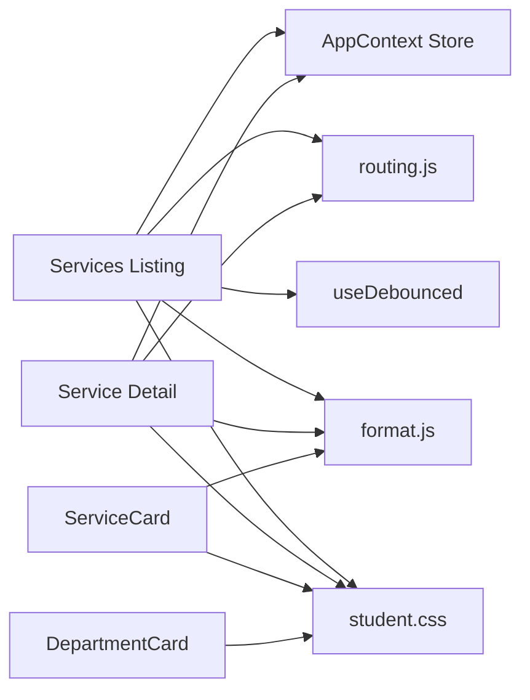

# Service Catalog

<cite>
**Referenced Files in This Document**
- [Services/index.jsx](file://src/pages/student/Services/index.jsx)
- [Services/ServiceDetail.jsx](file://src/pages/student/Services/ServiceDetail.jsx)
- [ServiceCard.jsx](file://src/components/student/ServiceCard.jsx)
- [DepartmentCard.jsx](file://src/components/student/DepartmentCard.jsx)
- [AppContext.jsx](file://src/context/AppContext.jsx)
- [routing.js](file://src/mocks/routing.js)
- [services.js](file://src/mocks/services.js)
- [departments.js](file://src/mocks/departments.js)
- [format.js](file://src/lib/format.js)
- [useDebounced.js](file://src/hooks/useDebounced.js)
- [student.css](file://src/styles/student.css)
</cite>

## Table of Contents
1. Introduction
2. Project Structure
3. Core Components
4. Architecture Overview
5. Detailed Component Analysis
6. Dependency Analysis
7. Performance Considerations
8. Troubleshooting Guide
9. Conclusion

## Introduction
This document explains the university service catalog browsing system used by students to discover, filter, and understand campus services. It covers:
- Discovering services via category chips and search
- Mapping services to departments for contact information
- Viewing detailed service pages with checklists, fees, deadlines, and freshness indicators
- The ServiceCard and DepartmentCard components that present service and department data
- Navigation flow between listings and details
- Data fetching patterns (current mock-based store), filtering logic, and responsive design for mobile and desktop

## Project Structure
The student-facing service catalog is implemented as React pages and components under the student section of the app. Key files include:
- Pages: Services listing and detail views
- Components: ServiceCard and DepartmentCard
- Context: AppContext provides a centralized store for services, fees, deadlines, and departments
- Mocks: Routing configuration and seed data for services and departments
- Utilities: Formatting helpers and debounced input hook
- Styles: Student-specific CSS for responsive layouts and cards

**Diagram sources**
- [Services/index.jsx:1-125](file://src/pages/student/Services/index.jsx#L1-L125)
- [Services/ServiceDetail.jsx:1-174](file://src/pages/student/Services/ServiceDetail.jsx#L1-L174)
- [ServiceCard.jsx:1-57](file://src/components/student/ServiceCard.jsx#L1-L57)
- [DepartmentCard.jsx:1-42](file://src/components/student/DepartmentCard.jsx#L1-L42)
- [AppContext.jsx:1-135](file://src/context/AppContext.jsx#L1-L135)
- [routing.js:1-77](file://src/mocks/routing.js#L1-L77)
- [services.js:1-309](file://src/mocks/services.js#L1-L309)
- [departments.js:1-18](file://src/mocks/departments.js#L1-L18)
- [format.js:1-32](file://src/lib/format.js#L1-L32)
- [useDebounced.js:1-12](file://src/hooks/useDebounced.js#L1-L12)
- [student.css:1-658](file://src/styles/student.css#L1-L658)

**Section sources**
- [Services/index.jsx:1-125](file://src/pages/student/Services/index.jsx#L1-L125)
- [Services/ServiceDetail.jsx:1-174](file://src/pages/student/Services/ServiceDetail.jsx#L1-L174)
- [AppContext.jsx:1-135](file://src/context/AppContext.jsx#L1-L135)
- [routing.js:1-77](file://src/mocks/routing.js#L1-L77)
- [services.js:1-309](file://src/mocks/services.js#L1-L309)
- [departments.js:1-18](file://src/mocks/departments.js#L1-L18)
- [format.js:1-32](file://src/lib/format.js#L1-L32)
- [useDebounced.js:1-12](file://src/hooks/useDebounced.js#L1-L12)
- [student.css:1-658](file://src/styles/student.css#L1-L658)

## Core Components
- Services listing page: Provides a search bar, category chips, active department banner, and a grid of ServiceCard items. Filters are applied based on URL category and debounced query.
- Service detail page: Shows procedure, checklist, fee, deadline, freshness warning, department info, and an action to ask the assistant about the service.
- ServiceCard: Displays service title in both languages, category badge, number of documents, optional fee and deadline, and a freshness indicator.
- DepartmentCard: Presents department name, phone/email links, campus location, hours, and verification status.

**Section sources**
- [Services/index.jsx:1-125](file://src/pages/student/Services/index.jsx#L1-L125)
- [Services/ServiceDetail.jsx:1-174](file://src/pages/student/Services/ServiceDetail.jsx#L1-L174)
- [ServiceCard.jsx:1-57](file://src/components/student/ServiceCard.jsx#L1-L57)
- [DepartmentCard.jsx:1-42](file://src/components/student/DepartmentCard.jsx#L1-L42)

## Architecture Overview
The system uses a client-side store provided by AppContext. In Phase 1, all data is seeded from mocks; in Phase 2, the store will be replaced by server state while keeping the same consumer interfaces. Filtering and display logic live in the pages and components, using utilities for formatting and debouncing.

**Diagram sources**
- [Services/index.jsx:1-125](file://src/pages/student/Services/index.jsx#L1-L125)
- [Services/ServiceDetail.jsx:1-174](file://src/pages/student/Services/ServiceDetail.jsx#L1-L174)
- [AppContext.jsx:1-135](file://src/context/AppContext.jsx#L1-L135)

## Detailed Component Analysis

### Services Listing Page
Responsibilities:
- Reads current category from URL query parameters and defaults to “all”
- Maintains local raw query state and debounces it for performance
- Computes filtered results using category and query against service titles, categories, and checklist items
- Resolves active department when a specific category is selected
- Renders empty state when no results match, otherwise renders a responsive grid of ServiceCard items

Filtering logic:
- Category filter: if not “all”, only services matching the selected category are shown
- Search filter: combines English title, Urdu title, category, and checklist items into a single searchable string and checks inclusion of the lowercased query

Department mapping:
- Uses CATEGORY_DEPARTMENT to map the selected category to a department id
- Finds the department object from the store to show contact info and hours

Navigation:
- Each ServiceCard links to /services/:id for the detail view

Performance considerations:
- Debounced search reduces re-renders during typing
- useMemo computes filtered results efficiently based on dependencies

Responsive design:
- Grid layout switches from single column on mobile to two columns on larger screens via CSS classes

**Section sources**
- [Services/index.jsx:1-125](file://src/pages/student/Services/index.jsx#L1-L125)
- [routing.js:1-77](file://src/mocks/routing.js#L1-L77)
- [useDebounced.js:1-12](file://src/hooks/useDebounced.js#L1-L12)
- [student.css:216-228](file://src/styles/student.css#L216-L228)

#### Filtering Flowchart

**Diagram sources**
- [Services/index.jsx:30-39](file://src/pages/student/Services/index.jsx#L30-L39)

### Service Detail Page
Responsibilities:
- Retrieves service by id from the store
- Resolves associated department via CATEGORY_DEPARTMENT mapping
- Resolves fee and deadline by matching service identifiers
- Computes freshness tone and shows a warning note if details are stale
- Renders procedure text in the active language, checklist with original/copy badges, and at-a-glance panel with fee, deadline, days left, last checked, and source
- Provides a direct link to call the department and a button to ask the assistant about the service

Navigation:
- Back link to the full services listing
- Action button navigates to chat with a pre-filled question about the service

Error handling:
- If service is not found, displays an empty state with a link back to all services

**Section sources**
- [Services/ServiceDetail.jsx:1-174](file://src/pages/student/Services/ServiceDetail.jsx#L1-L174)
- [routing.js:1-77](file://src/mocks/routing.js#L1-L77)
- [format.js:1-32](file://src/lib/format.js#L1-L32)

#### Detail View Sequence

**Diagram sources**
- [Services/ServiceDetail.jsx:20-45](file://src/pages/student/Services/ServiceDetail.jsx#L20-L45)
- [format.js:1-32](file://src/lib/format.js#L1-L32)

### ServiceCard Component
Responsibilities:
- Displays bilingual service title and category badge
- Shows number of required documents
- Optionally shows fee amount and deadline date
- Displays freshness indicator without text

Design:
- Acts as a clickable card linking to the service detail page
- Uses consistent spacing and typography aligned with student styles

**Section sources**
- [ServiceCard.jsx:1-57](file://src/components/student/ServiceCard.jsx#L1-L57)
- [student.css:229-275](file://src/styles/student.css#L229-L275)

### DepartmentCard Component
Responsibilities:
- Displays department name in both languages
- Provides tel: and mailto: links for phone and email
- Shows campus location and operating hours
- Includes a verification ladder indicating last checked date

Design:
- Optimized for mobile users with large tap targets and clear hierarchy

**Section sources**
- [DepartmentCard.jsx:1-42](file://src/components/student/DepartmentCard.jsx#L1-L42)
- [student.css:543-579](file://src/styles/student.css#L543-L579)

## Dependency Analysis
Key relationships:
- Services listing depends on:
  - AppContext store for services, fees, deadlines, departments
  - routing.js for category-to-department mapping and category definitions
  - useDebounced hook for efficient search
  - format.js for date and currency formatting
  - student.css for responsive grids and card styling
- Service detail depends on:
  - AppContext store for service, department, fee, deadline
  - routing.js for category-to-department mapping
  - format.js for date formatting and days calculation
  - student.css for detail layout and panels
- Components depend on:
  - format.js for displaying formatted values
  - student.css for consistent visual presentation

**Diagram sources**
- [Services/index.jsx:1-125](file://src/pages/student/Services/index.jsx#L1-L125)
- [Services/ServiceDetail.jsx:1-174](file://src/pages/student/Services/ServiceDetail.jsx#L1-L174)
- [ServiceCard.jsx:1-57](file://src/components/student/ServiceCard.jsx#L1-L57)
- [DepartmentCard.jsx:1-42](file://src/components/student/DepartmentCard.jsx#L1-L42)
- [AppContext.jsx:1-135](file://src/context/AppContext.jsx#L1-L135)
- [routing.js:1-77](file://src/mocks/routing.js#L1-L77)
- [format.js:1-32](file://src/lib/format.js#L1-L32)
- [student.css:1-658](file://src/styles/student.css#L1-L658)

**Section sources**
- [Services/index.jsx:1-125](file://src/pages/student/Services/index.jsx#L1-L125)
- [Services/ServiceDetail.jsx:1-174](file://src/pages/student/Services/ServiceDetail.jsx#L1-L174)
- [AppContext.jsx:1-135](file://src/context/AppContext.jsx#L1-L135)
- [routing.js:1-77](file://src/mocks/routing.js#L1-L77)
- [format.js:1-32](file://src/lib/format.js#L1-L32)
- [student.css:1-658](file://src/styles/student.css#L1-L658)

## Performance Considerations
- Debounced search: Reduces unnecessary re-renders while typing by delaying query updates
- Memoized filtering: Uses memoization to compute filtered results only when dependencies change
- Client-side store: Fast reads and filters for small datasets; plan to replace with server state in Phase 2 for scalability
- Responsive grid: CSS grid adapts to screen size, minimizing layout shifts and improving perceived performance on mobile

[No sources needed since this section provides general guidance]

## Troubleshooting Guide
Common issues and resolutions:
- No results after searching:
  - Clear the search input to reset filters
  - Try broader terms or switch categories
- Stale details warning:
  - A freshness note appears when the verified date is older than expected; call the department before visiting
- Missing service detail:
  - If the service id is invalid or removed, the detail page shows an empty state with a link back to all services
- Incorrect department mapping:
  - Ensure the service’s category matches entries in CATEGORY_DEPARTMENT; mismatches can hide department info

**Section sources**
- [Services/index.jsx:107-114](file://src/pages/student/Services/index.jsx#L107-L114)
- [Services/ServiceDetail.jsx:26-38](file://src/pages/student/Services/ServiceDetail.jsx#L26-L38)
- [Services/ServiceDetail.jsx:102-107](file://src/pages/student/Services/ServiceDetail.jsx#L102-L107)
- [routing.js:11-18](file://src/mocks/routing.js#L11-L18)

## Conclusion
The service catalog provides a streamlined way for students to discover and understand university services through category filtering and search, with clear navigation to detailed views. The design emphasizes clarity, accessibility, and responsiveness across devices. The current implementation uses a client-side store seeded from mocks, with a planned migration to server state in Phase 2. Components like ServiceCard and DepartmentCard ensure consistent presentation of critical information such as fees, deadlines, checklists, and department contacts.

[No sources needed since this section summarizes without analyzing specific files]