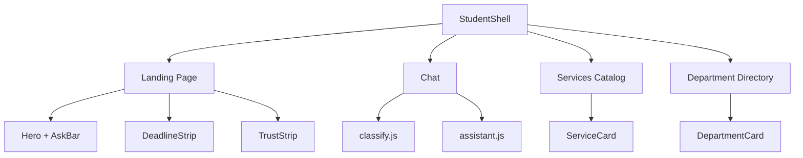
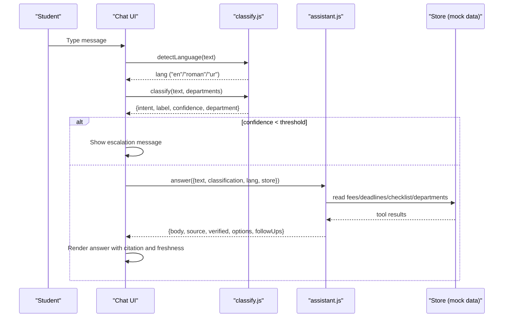
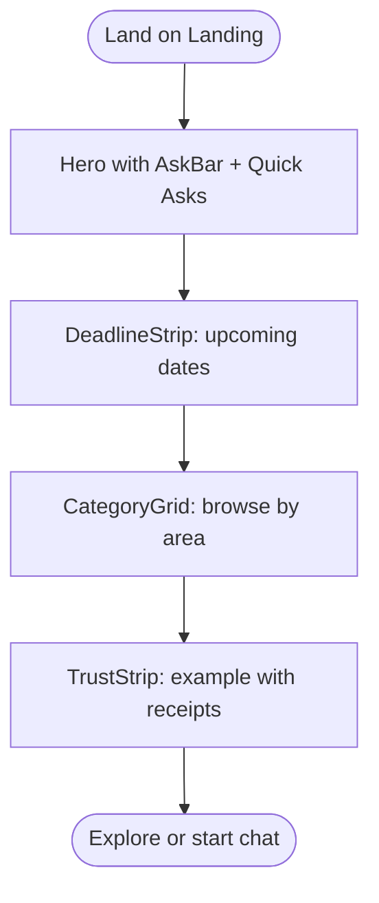
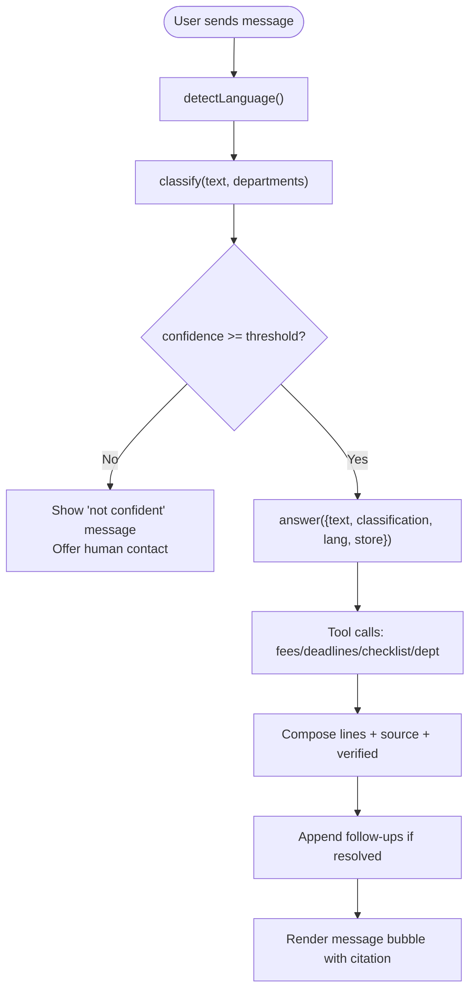
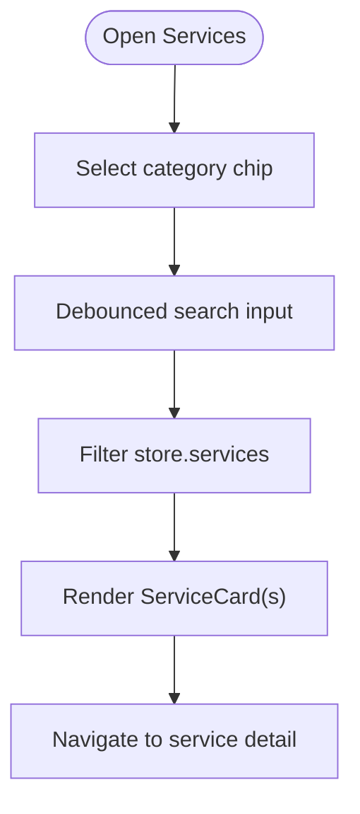
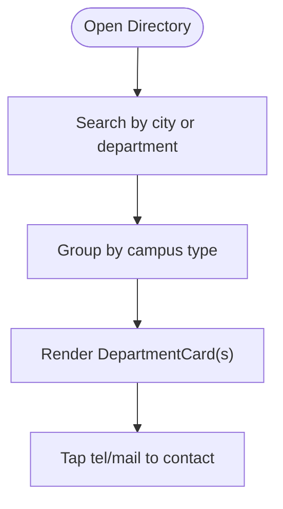
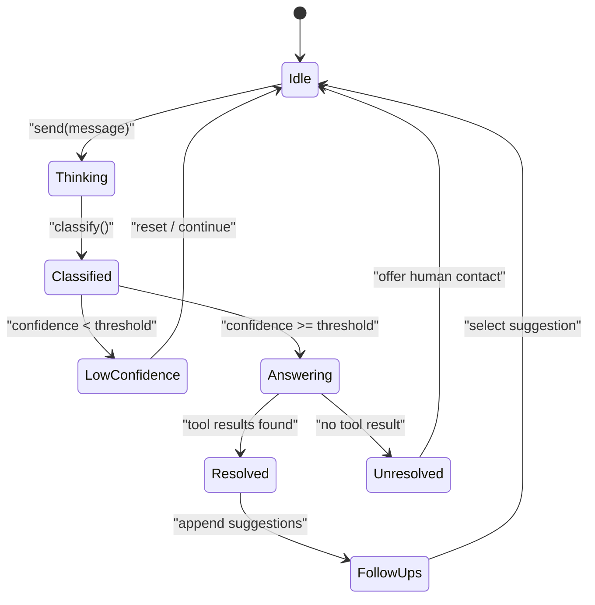
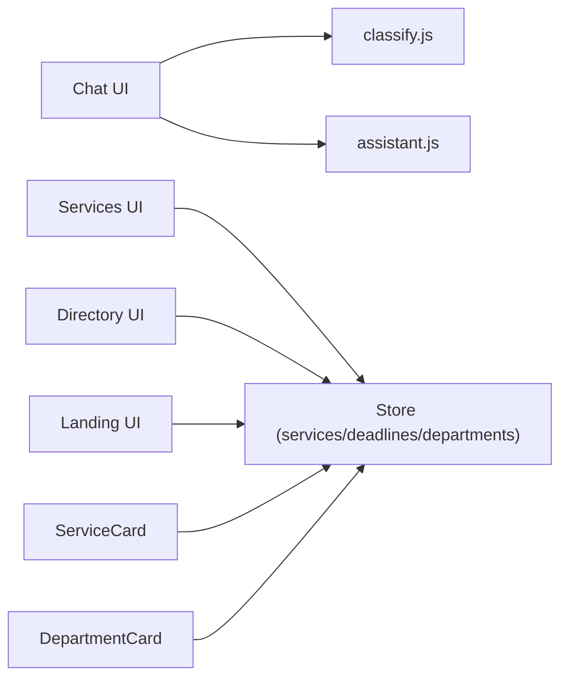

# Student Interface

<cite>
**Referenced Files in This Document**
- [src/pages/student/Landing/index.jsx](file://src/pages/student/Landing/index.jsx)
- [src/pages/student/Landing/Hero.jsx](file://src/pages/student/Landing/Hero.jsx)
- [src/pages/student/Landing/DeadlineStrip.jsx](file://src/pages/student/Landing/DeadlineStrip.jsx)
- [src/pages/student/Landing/TrustStrip.jsx](file://src/pages/student/Landing/TrustStrip.jsx)
- [src/pages/student/Chat/index.jsx](file://src/pages/student/Chat/index.jsx)
- [src/lib/classify.js](file://src/lib/classify.js)
- [src/lib/assistant.js](file://src/lib/assistant.js)
- [src/pages/student/Services/index.jsx](file://src/pages/student/Services/index.jsx)
- [src/components/student/ServiceCard.jsx](file://src/components/student/ServiceCard.jsx)
- [src/pages/student/Directory/index.jsx](file://src/pages/student/Directory/index.jsx)
- [src/components/student/DepartmentCard.jsx](file://src/components/student/DepartmentCard.jsx)
- [src/components/student/StudentShell.jsx](file://src/components/student/StudentShell.jsx)
</cite>

## Table of Contents
1. Introduction
2. Project Structure
3. Core Components
4. Architecture Overview
5. Detailed Component Analysis
6. Dependency Analysis
7. Performance Considerations
8. Troubleshooting Guide
9. Conclusion

## Introduction
This document describes the student-facing interface of UAEA Console. It covers the landing page with service discovery, deadline tracking, and a trust model; the chat interface with multi-language support (Urdu, Roman Urdu, English), intent classification, and conversation flow; the service catalog with department filtering and search; the department directory with contact information and campus mapping; guided flows and escalation handling when confidence thresholds are not met; and accessibility and responsive design patterns tailored for students.

## Project Structure
The student experience is composed of:
- A shared shell that frames pages and hides the footer on the chat screen to keep the composer pinned at the bottom.
- A landing page that prioritizes immediate action (Ask Bar), upcoming deadlines, how it works, category navigation, and a trust example.
- A chat interface that classifies input, routes to tools, answers grounded in records, and shows citations and follow-ups.
- A services catalog with category chips and debounced search.
- A department directory grouped by campus type with search across names, cities, and phone numbers.

**Diagram sources**
- [src/components/student/StudentShell.jsx:1-25](file://src/components/student/StudentShell.jsx#L1-L25)
- [src/pages/student/Landing/index.jsx:1-25](file://src/pages/student/Landing/index.jsx#L1-L25)
- [src/pages/student/Chat/index.jsx:1-200](file://src/pages/student/Chat/index.jsx#L1-L200)
- [src/pages/student/Services/index.jsx:1-125](file://src/pages/student/Services/index.jsx#L1-L125)
- [src/pages/student/Directory/index.jsx:1-80](file://src/pages/student/Directory/index.jsx#L1-L80)

**Section sources**
- [src/components/student/StudentShell.jsx:1-25](file://src/components/student/StudentShell.jsx#L1-L25)
- [src/pages/student/Landing/index.jsx:1-25](file://src/pages/student/Landing/index.jsx#L1-L25)

## Core Components
- Landing page: Hero with Ask Bar and quick asks; DeadlineStrip showing upcoming dates with urgency badges; CategoryGrid for browsing; TrustStrip demonstrating source-cited answers and freshness.
- Chat: Multi-language greeting and response; classify → route → look up → answer → cite pipeline; escalation when confidence is below threshold; follow-up suggestions.
- Services catalog: Category chips bound to URL state; debounced search across English, Urdu, category, and checklist items; fee and deadline summaries per card.
- Department directory: Grouped by main campus vs regional campuses; search across name, city, phone; tel/mail links for direct contact.

**Section sources**
- [src/pages/student/Landing/Hero.jsx:1-40](file://src/pages/student/Landing/Hero.jsx#L1-L40)
- [src/pages/student/Landing/DeadlineStrip.jsx:1-72](file://src/pages/student/Landing/DeadlineStrip.jsx#L1-L72)
- [src/pages/student/Landing/TrustStrip.jsx:1-59](file://src/pages/student/Landing/TrustStrip.jsx#L1-L59)
- [src/pages/student/Chat/index.jsx:1-200](file://src/pages/student/Chat/index.jsx#L1-L200)
- [src/lib/classify.js:1-270](file://src/lib/classify.js#L1-L270)
- [src/lib/assistant.js:1-364](file://src/lib/assistant.js#L1-L364)
- [src/pages/student/Services/index.jsx:1-125](file://src/pages/student/Services/index.jsx#L1-L125)
- [src/components/student/ServiceCard.jsx:1-57](file://src/components/student/ServiceCard.jsx#L1-L57)
- [src/pages/student/Directory/index.jsx:1-80](file://src/pages/student/Directory/index.jsx#L1-L80)
- [src/components/student/DepartmentCard.jsx:1-42](file://src/components/student/DepartmentCard.jsx#L1-L42)

## Architecture Overview
The student interface follows a clear separation between UI and logic:
- UI components render pages and compose interactions.
- classify.js provides language detection, normalization, and deterministic intent scoring with confidence.
- assistant.js composes grounded answers from tool calls (fees, deadlines, checklists, departments) and formats responses in three languages.
- The chat orchestrates the flow and handles low-confidence escalations.

**Diagram sources**
- [src/pages/student/Chat/index.jsx:62-138](file://src/pages/student/Chat/index.jsx#L62-L138)
- [src/lib/classify.js:51-57](file://src/lib/classify.js#L51-L57)
- [src/lib/classify.js:201-269](file://src/lib/classify.js#L201-L269)
- [src/lib/assistant.js:135-317](file://src/lib/assistant.js#L135-L317)

## Detailed Component Analysis

### Landing Page
- Hero presents a concise value proposition, an Ask Bar, and quick ask chips that navigate to the chat with a pre-filled question.
- DeadlineStrip surfaces upcoming deadlines sorted by date, with a badge indicating days remaining and a link to all services.
- TrustStrip demonstrates a fully sourced answer with routing, tool call, source badge, and freshness ladder to build confidence.

**Diagram sources**
- [src/pages/student/Landing/Hero.jsx:1-40](file://src/pages/student/Landing/Hero.jsx#L1-L40)
- [src/pages/student/Landing/DeadlineStrip.jsx:1-72](file://src/pages/student/Landing/DeadlineStrip.jsx#L1-L72)
- [src/pages/student/Landing/TrustStrip.jsx:1-59](file://src/pages/student/Landing/TrustStrip.jsx#L1-L59)

**Section sources**
- [src/pages/student/Landing/index.jsx:1-25](file://src/pages/student/Landing/index.jsx#L1-L25)
- [src/pages/student/Landing/Hero.jsx:1-40](file://src/pages/student/Landing/Hero.jsx#L1-L40)
- [src/pages/student/Landing/DeadlineStrip.jsx:1-72](file://src/pages/student/Landing/DeadlineStrip.jsx#L1-L72)
- [src/pages/student/Landing/TrustStrip.jsx:1-59](file://src/pages/student/Landing/TrustStrip.jsx#L1-L59)

### Chat Interface and Conversation Flow
- Language detection supports Urdu script, Roman Urdu via function words, and English.
- Intent classification uses keyword rules with strong/weak scoring and returns confidence.
- If confidence is below a floor, the chat displays an escalation message and avoids guessing.
- Otherwise, assistant builds answers strictly from tool results, includes source and verification date, and offers follow-ups.

**Diagram sources**
- [src/pages/student/Chat/index.jsx:62-138](file://src/pages/student/Chat/index.jsx#L62-L138)
- [src/lib/classify.js:51-57](file://src/lib/classify.js#L51-L57)
- [src/lib/classify.js:201-269](file://src/lib/classify.js#L201-L269)
- [src/lib/assistant.js:135-317](file://src/lib/assistant.js#L135-L317)

**Section sources**
- [src/pages/student/Chat/index.jsx:1-200](file://src/pages/student/Chat/index.jsx#L1-L200)
- [src/lib/classify.js:1-270](file://src/lib/classify.js#L1-L270)
- [src/lib/assistant.js:1-364](file://src/lib/assistant.js#L1-L364)

### Service Catalog Browsing
- Category chips filter services by area and persist in URL query parameters for shareable links.
- Debounced search scans English, Urdu, category, and checklist text for fast, relevant results.
- Each service card summarizes documents, fee, deadline, and last-checked freshness.

**Diagram sources**
- [src/pages/student/Services/index.jsx:1-125](file://src/pages/student/Services/index.jsx#L1-L125)
- [src/components/student/ServiceCard.jsx:1-57](file://src/components/student/ServiceCard.jsx#L1-L57)

**Section sources**
- [src/pages/student/Services/index.jsx:1-125](file://src/pages/student/Services/index.jsx#L1-L125)
- [src/components/student/ServiceCard.jsx:1-57](file://src/components/student/ServiceCard.jsx#L1-L57)

### Department Directory
- Groups departments into main campus and regional campuses.
- Search spans department name, Urdu name, campus, and phone number.
- Cards expose tel/mail links, campus location, office hours, and freshness indicator.

**Diagram sources**
- [src/pages/student/Directory/index.jsx:1-80](file://src/pages/student/Directory/index.jsx#L1-L80)
- [src/components/student/DepartmentCard.jsx:1-42](file://src/components/student/DepartmentCard.jsx#L1-L42)

**Section sources**
- [src/pages/student/Directory/index.jsx:1-80](file://src/pages/student/Directory/index.jsx#L1-L80)
- [src/components/student/DepartmentCard.jsx:1-42](file://src/components/student/DepartmentCard.jsx#L1-L42)

### Guided Flows and Escalation Handling
- Guided prompts: After a resolved answer, follow-up suggestions appear to guide next steps.
- Slotting: For ambiguous intents like fee tariff without a program, the system asks clarifying questions and presents options.
- Escalation: When classification confidence is below the threshold, the chat avoids guessing and suggests contacting the appropriate department.

**Diagram sources**
- [src/pages/student/Chat/index.jsx:62-138](file://src/pages/student/Chat/index.jsx#L62-L138)
- [src/lib/classify.js:201-269](file://src/lib/classify.js#L201-L269)
- [src/lib/assistant.js:163-187](file://src/lib/assistant.js#L163-L187)
- [src/lib/assistant.js:259-283](file://src/lib/assistant.js#L259-L283)

**Section sources**
- [src/pages/student/Chat/index.jsx:1-200](file://src/pages/student/Chat/index.jsx#L1-L200)
- [src/lib/classify.js:1-270](file://src/lib/classify.js#L1-L270)
- [src/lib/assistant.js:1-364](file://src/lib/assistant.js#L1-L364)

### Accessibility and Responsive Design
- Keyboard and screen-reader friendly inputs with aria-labels on search fields.
- Large tap targets for quick asks and chips; mobile-friendly tel/mail links in department cards.
- Footer hidden on chat to keep the composer accessible at the bottom of the viewport.
- Clear visual hierarchy with eyebrow labels, headings, and badges to aid scanning.

**Section sources**
- [src/components/student/StudentShell.jsx:1-25](file://src/components/student/StudentShell.jsx#L1-L25)
- [src/pages/student/Services/index.jsx:56-64](file://src/pages/student/Services/index.jsx#L56-L64)
- [src/pages/student/Directory/index.jsx:43-51](file://src/pages/student/Directory/index.jsx#L43-L51)
- [src/components/student/DepartmentCard.jsx:16-33](file://src/components/student/DepartmentCard.jsx#L16-L33)

## Dependency Analysis
Key dependencies among student-facing modules:
- Chat depends on classify.js for language detection and intent scoring, and on assistant.js for answer composition.
- Landing, Services, and Directory depend on shared store data (services, deadlines, departments) surfaced through context.
- ServiceCard and DepartmentCard rely on formatting utilities and freshness indicators.

**Diagram sources**
- [src/pages/student/Chat/index.jsx:1-200](file://src/pages/student/Chat/index.jsx#L1-L200)
- [src/lib/classify.js:1-270](file://src/lib/classify.js#L1-L270)
- [src/lib/assistant.js:1-364](file://src/lib/assistant.js#L1-L364)
- [src/pages/student/Services/index.jsx:1-125](file://src/pages/student/Services/index.jsx#L1-L125)
- [src/pages/student/Directory/index.jsx:1-80](file://src/pages/student/Directory/index.jsx#L1-L80)
- [src/components/student/ServiceCard.jsx:1-57](file://src/components/student/ServiceCard.jsx#L1-L57)
- [src/components/student/DepartmentCard.jsx:1-42](file://src/components/student/DepartmentCard.jsx#L1-L42)

**Section sources**
- [src/pages/student/Chat/index.jsx:1-200](file://src/pages/student/Chat/index.jsx#L1-L200)
- [src/lib/classify.js:1-270](file://src/lib/classify.js#L1-L270)
- [src/lib/assistant.js:1-364](file://src/lib/assistant.js#L1-L364)
- [src/pages/student/Services/index.jsx:1-125](file://src/pages/student/Services/index.jsx#L1-L125)
- [src/pages/student/Directory/index.jsx:1-80](file://src/pages/student/Directory/index.jsx#L1-L80)
- [src/components/student/ServiceCard.jsx:1-57](file://src/components/student/ServiceCard.jsx#L1-L57)
- [src/components/student/DepartmentCard.jsx:1-42](file://src/components/student/DepartmentCard.jsx#L1-L42)

## Performance Considerations
- Debounced search reduces re-renders while typing in Services and Directory.
- Classification and answer composition run client-side for responsiveness; latency simulation improves perceived clarity during complex flows.
- Avoid heavy computations in render paths; use memoization where applicable for filtered lists.

[No sources needed since this section provides general guidance]

## Troubleshooting Guide
- Misrouted or unrecognized queries: The chat detects low confidence and shows a clear message rather than guessing. Verify that keywords match the rule set and consider refining phrasing.
- Missing data: If no tool result is found, the assistant declines to guess and suggests contacting the relevant department. Confirm that the underlying record exists and is marked verified.
- Language issues: Ensure input contains expected markers for Roman Urdu or Urdu script; the classifier relies on specific function words and Unicode ranges.

**Section sources**
- [src/pages/student/Chat/index.jsx:77-111](file://src/pages/student/Chat/index.jsx#L77-L111)
- [src/lib/classify.js:201-269](file://src/lib/classify.js#L201-L269)
- [src/lib/assistant.js:312-317](file://src/lib/assistant.js#L312-L317)

## Conclusion
The student interface delivers a focused, trustworthy experience: immediate access to urgent deadlines, a conversational assistant that speaks Urdu, Roman Urdu, and English, transparent sourcing and freshness, and easy ways to find services and contacts. The architecture keeps answers grounded in records, escalates responsibly when uncertain, and provides guided next steps to keep students moving forward efficiently.