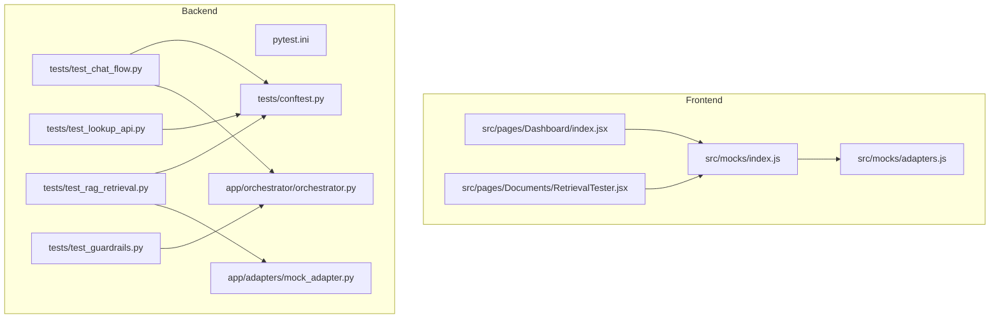
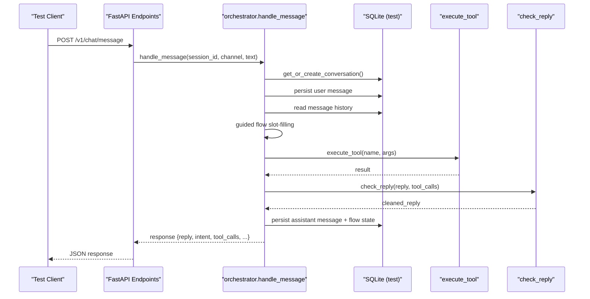
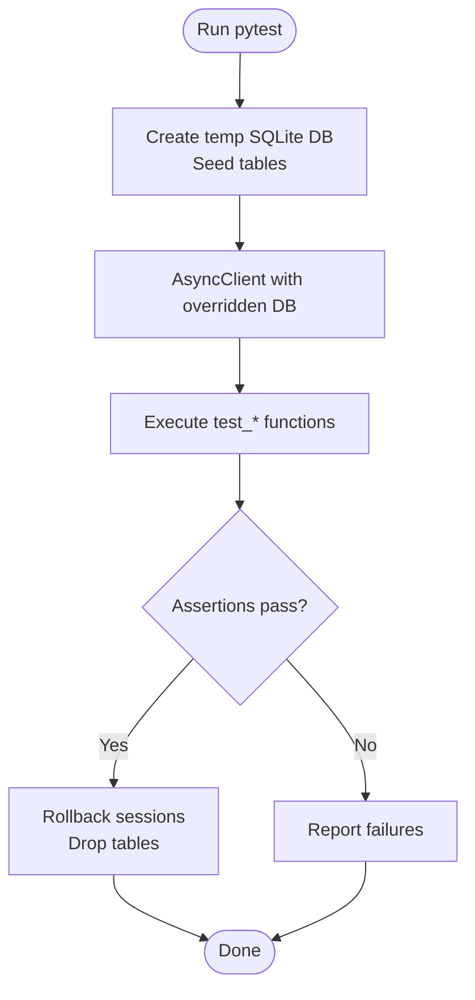
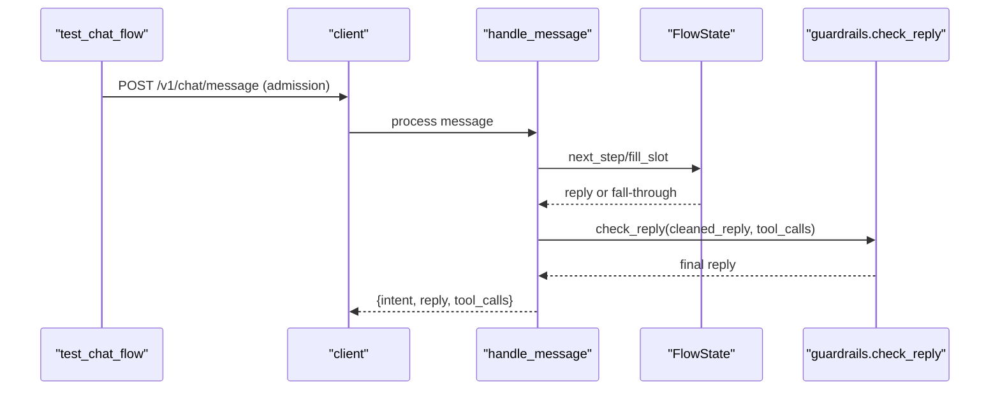
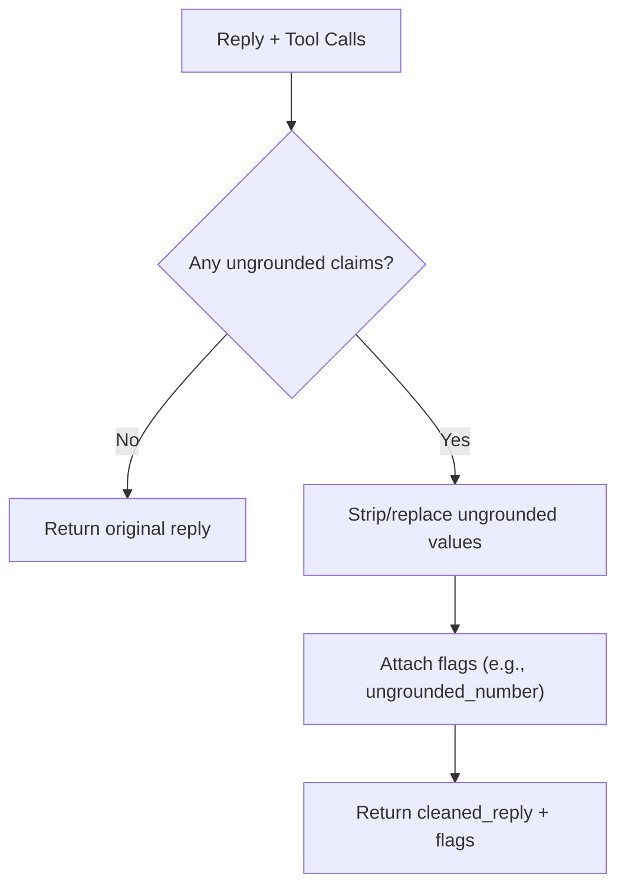
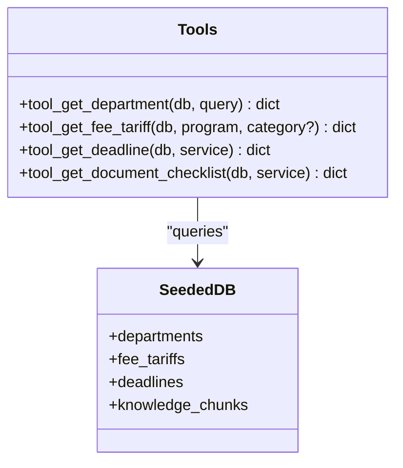
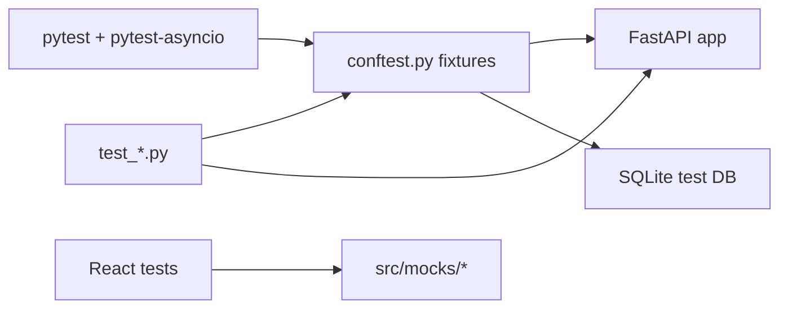

# Testing Strategy

<cite>
**Referenced Files in This Document**
- [package.json](file://package.json)
- [vite.config.js](file://vite.config.js)
- [README.md](file://README.md)
- [src/mocks/index.js](file://src/mocks/index.js)
- [src/mocks/adapters.js](file://src/mocks/adapters.js)
- [src/pages/Dashboard/index.jsx](file://src/pages/Dashboard/index.jsx)
- [src/pages/Documents/RetrievalTester.jsx](file://src/pages/Documents/RetrievalTester.jsx)
- [uaea-backend/pytest.ini](file://uaea-backend/pytest.ini)
- [uaea-backend/tests/conftest.py](file://uaea-backend/tests/conftest.py)
- [uaea-backend/tests/test_chat_flow.py](file://uaea-backend/tests/test_chat_flow.py)
- [uaea-backend/tests/test_guardrails.py](file://uaea-backend/tests/test_guardrails.py)
- [uaea-backend/tests/test_lookup_api.py](file://uaea-backend/tests/test_lookup_api.py)
- [uaea-backend/tests/test_rag_retrieval.py](file://uaea-backend/tests/test_rag_retrieval.py)
- [uaea-backend/app/adapters/mock_adapter.py](file://uaea-backend/app/adapters/mock_adapter.py)
- [uaea-backend/app/orchestrator/orchestrator.py](file://uaea-backend/app/orchestrator/orchestrator.py)
</cite>

## Table of Contents
1. Introduction
2. Project Structure
3. Core Components
4. Architecture Overview
5. Detailed Component Analysis
6. Dependency Analysis
7. Performance Considerations
8. Troubleshooting Guide
9. Conclusion

## Introduction
This document describes the testing strategy for the UAEA Console application, covering unit tests for React components, backend API and integration tests, orchestrator pipeline validation, test data management with fixtures and mock adapters, end-to-end procedures for critical workflows, performance and load testing approaches, continuous integration setup, coverage requirements, debugging techniques, and maintenance best practices. The goal is to provide a clear, actionable guide for developers and QA engineers to write reliable tests that reflect real user journeys while keeping external dependencies isolated.

## Project Structure
The repository contains:
- A React front-end under src with pages, components, hooks, lib utilities, and a mocks layer used by UI features and tests.
- A Python backend under uaea-backend with FastAPI endpoints, an orchestrator pipeline, database models, and a comprehensive pytest suite.

Key testing-related structure:
- Frontend mocks: src/mocks provides canned data and adapter definitions consumed by pages and tests.
- Backend tests: uaea-backend/tests contains API, guardrail, RAG retrieval, and chat flow tests using pytest and httpx AsyncClient.
- Test configuration: pytest.ini sets asyncio mode and test paths; conftest.py defines shared fixtures including a seeded SQLite database and HTTP client.

**Diagram sources**
- [src/mocks/index.js:1-19](file://src/mocks/index.js#L1-L19)
- [src/mocks/adapters.js:1-64](file://src/mocks/adapters.js#L1-L64)
- [src/pages/Dashboard/index.jsx:1-43](file://src/pages/Dashboard/index.jsx#L1-L43)
- [src/pages/Documents/RetrievalTester.jsx:92-101](file://src/pages/Documents/RetrievalTester.jsx#L92-L101)
- [uaea-backend/pytest.ini:1-4](file://uaea-backend/pytest.ini#L1-L4)
- [uaea-backend/tests/conftest.py:1-191](file://uaea-backend/tests/conftest.py#L1-L191)
- [uaea-backend/tests/test_chat_flow.py:1-176](file://uaea-backend/tests/test_chat_flow.py#L1-L176)
- [uaea-backend/tests/test_guardrails.py:1-87](file://uaea-backend/tests/test_guardrails.py#L1-L87)
- [uaea-backend/tests/test_lookup_api.py:1-112](file://uaea-backend/tests/test_lookup_api.py#L1-L112)
- [uaea-backend/tests/test_rag_retrieval.py:1-135](file://uaea-backend/tests/test_rag_retrieval.py#L1-L135)
- [uaea-backend/app/orchestrator/orchestrator.py:1-405](file://uaea-backend/app/orchestrator/orchestrator.py#L1-L405)
- [uaea-backend/app/adapters/mock_adapter.py:1-61](file://uaea-backend/app/adapters/mock_adapter.py#L1-L61)

**Section sources**
- [package.json:1-23](file://package.json#L1-L23)
- [vite.config.js:1-13](file://vite.config.js#L1-L13)
- [README.md:194-209](file://README.md#L194-L209)

## Core Components
- Orchestrator pipeline: Processes incoming messages through normalization, intent classification, guided flow state machine, LLM tool calls, guardrails, and persistence. Tests validate each stage via API and unit tests.
- Mock adapters: Provide deterministic responses for student system integrations (fees, results, assignments, service requests), enabling end-to-end flows without external systems.
- Test fixtures: A session-scoped engine and seeded database ensure consistent data across tests; an async HTTP client overrides DB dependency for endpoint tests.

Testing highlights:
- Chat flow tests exercise guided admission flow, session history, escalation, small talk classification, admin auth, and prompt injection sanitization.
- Guardrail tests verify ungrounded numbers/dates are stripped or replaced when not backed by tool results.
- Lookup API tests assert correct filtering and content from seeded data.
- RAG retrieval tests validate tools against seeded knowledge chunks and normalizer/intent behavior.

**Section sources**
- [uaea-backend/app/orchestrator/orchestrator.py:46-143](file://uaea-backend/app/orchestrator/orchestrator.py#L46-L143)
- [uaea-backend/app/adapters/mock_adapter.py:12-61](file://uaea-backend/app/adapters/mock_adapter.py#L12-L61)
- [uaea-backend/tests/conftest.py:48-191](file://uaea-backend/tests/conftest.py#L48-L191)
- [uaea-backend/tests/test_chat_flow.py:44-176](file://uaea-backend/tests/test_chat_flow.py#L44-L176)
- [uaea-backend/tests/test_guardrails.py:7-87](file://uaea-backend/tests/test_guardrails.py#L7-L87)
- [uaea-backend/tests/test_lookup_api.py:7-112](file://uaea-backend/tests/test_lookup_api.py#L7-L112)
- [uaea-backend/tests/test_rag_retrieval.py:12-135](file://uaea-backend/tests/test_rag_retrieval.py#L12-L135)

## Architecture Overview
The chat message lifecycle spans multiple stages validated by tests:

**Diagram sources**
- [uaea-backend/app/orchestrator/orchestrator.py:46-143](file://uaea-backend/app/orchestrator/orchestrator.py#L46-L143)
- [uaea-backend/tests/test_chat_flow.py:44-100](file://uaea-backend/tests/test_chat_flow.py#L44-L100)

## Detailed Component Analysis

### Backend API and Integration Tests
- Fixture-driven HTTP tests use an in-memory SQLite database seeded with departments, services, fees, deadlines, and knowledge chunks.
- Admin endpoints require an API key; tests assert 403 without it and success with a valid key.
- Lookup endpoints return filtered lists based on query parameters and seed data.

**Diagram sources**
- [uaea-backend/tests/conftest.py:48-191](file://uaea-backend/tests/conftest.py#L48-L191)
- [uaea-backend/tests/test_lookup_api.py:7-112](file://uaea-backend/tests/test_lookup_api.py#L7-L112)
- [uaea-backend/tests/test_chat_flow.py:139-162](file://uaea-backend/tests/test_chat_flow.py#L139-L162)

**Section sources**
- [uaea-backend/tests/test_lookup_api.py:7-112](file://uaea-backend/tests/test_lookup_api.py#L7-L112)
- [uaea-backend/tests/test_chat_flow.py:139-162](file://uaea-backend/tests/test_chat_flow.py#L139-L162)
- [uaea-backend/tests/conftest.py:48-191](file://uaea-backend/tests/conftest.py#L48-L191)

### Orchestrator Pipeline Validation
- Guided flow tests simulate multi-turn conversations to fill slots and trigger tool calls.
- Prompt injection stripping is verified to prevent malicious instructions from affecting responses.
- Small talk classification ensures non-task messages are handled appropriately.

**Diagram sources**
- [uaea-backend/tests/test_chat_flow.py:44-81](file://uaea-backend/tests/test_chat_flow.py#L44-L81)
- [uaea-backend/app/orchestrator/orchestrator.py:146-226](file://uaea-backend/app/orchestrator/orchestrator.py#L146-L226)
- [uaea-backend/app/orchestrator/orchestrator.py:98-100](file://uaea-backend/app/orchestrator/orchestrator.py#L98-L100)

**Section sources**
- [uaea-backend/tests/test_chat_flow.py:44-176](file://uaea-backend/tests/test_chat_flow.py#L44-L176)
- [uaea-backend/app/orchestrator/orchestrator.py:146-226](file://uaea-backend/app/orchestrator/orchestrator.py#L146-L226)

### Guardrails Unit Tests
- Verify that ungrounded numbers and dates are stripped or replaced when not supported by tool results.
- Ensure grounded values from tool calls pass through unchanged.
- Validate extraction of grounded values from nested tool results.

**Diagram sources**
- [uaea-backend/tests/test_guardrails.py:7-87](file://uaea-backend/tests/test_guardrails.py#L7-L87)

**Section sources**
- [uaea-backend/tests/test_guardrails.py:7-87](file://uaea-backend/tests/test_guardrails.py#L7-L87)

### RAG Retrieval and Tools Tests
- Validate tools returning department info, fee tariffs, deadlines, and document checklists against seeded data.
- Confirm error handling for unknown queries.
- Test language normalization and intent classification correctness.

**Diagram sources**
- [uaea-backend/tests/test_rag_retrieval.py:12-99](file://uaea-backend/tests/test_rag_retrieval.py#L12-L99)
- [uaea-backend/tests/conftest.py:81-176](file://uaea-backend/tests/conftest.py#L81-L176)

**Section sources**
- [uaea-backend/tests/test_rag_retrieval.py:12-135](file://uaea-backend/tests/test_rag_retrieval.py#L12-L135)

### Frontend Testing Strategy
- Use the existing mocks layer to isolate UI tests from backend services. Import from the barrel to swap implementations easily.
- For component tests, render components with mocked data from src/mocks and assert interactions and rendering outcomes.
- For feature-level tests, simulate user flows such as dashboard range changes and document retrieval testing using the provided UI elements.

Recommended libraries and approach:
- React Testing Library for component assertions and interaction simulation.
- Vite-compatible test runner (e.g., Vitest) configured via vite.config.js aliases to resolve @ imports consistently.
- Mock fetch or network layer if needed; otherwise rely on src/mocks for deterministic data.

Example strategies:
- Dashboard metrics: Render MetricTile with fixture data and assert labels, units, and deltas.
- Retrieval tester: Trigger search actions and assert presence of results or empty states.

**Section sources**
- [src/mocks/index.js:1-19](file://src/mocks/index.js#L1-L19)
- [src/pages/Dashboard/index.jsx:1-43](file://src/pages/Dashboard/index.jsx#L1-L43)
- [src/pages/Documents/RetrievalTester.jsx:92-101](file://src/pages/Documents/RetrievalTester.jsx#L92-L101)
- [vite.config.js:1-13](file://vite.config.js#L1-L13)

### End-to-End Testing Procedures
- Chat interactions: Use the HTTP client to send messages, follow guided flows, and assert replies and intents. Validate escalation creation and session history retrieval.
- Content management operations: Leverage lookup endpoints to verify CRUD-like behaviors indirectly via read paths and filters; extend with write endpoints as they become available.
- Guided flow execution: Multi-turn sequences that fill slots and transition to tool-backed summaries; assert intermediate prompts and final outputs.

**Section sources**
- [uaea-backend/tests/test_chat_flow.py:44-176](file://uaea-backend/tests/test_chat_flow.py#L44-L176)
- [uaea-backend/tests/test_lookup_api.py:7-112](file://uaea-backend/tests/test_lookup_api.py#L7-L112)

### Test Data Management
- Fixtures: conftest.py creates a temporary SQLite database per session, seeds core entities, and provides a session-scoped AsyncSession and HTTP client with dependency overrides.
- Mock adapters: mock_adapter.py returns realistic payloads for student system integrations, enabling stable E2E flows without external dependencies.
- Frontend mocks: src/mocks exports canned datasets and adapter interface definitions for UI tests and development.

Best practices:
- Keep fixtures idempotent and scoped appropriately (session vs function).
- Prefer minimal seed data that covers all assertion paths.
- Centralize mock definitions to simplify swapping between phases.

**Section sources**
- [uaea-backend/tests/conftest.py:17-191](file://uaea-backend/tests/conftest.py#L17-L191)
- [uaea-backend/app/adapters/mock_adapter.py:12-61](file://uaea-backend/app/adapters/mock_adapter.py#L12-L61)
- [src/mocks/adapters.js:10-64](file://src/mocks/adapters.js#L10-L64)

### Performance and Load Testing
- Backend: Use pytest benchmarks or dedicated load tools (e.g., Locust) to simulate concurrent chat requests and measure latency under load. Focus on orchestrator loops and DB queries.
- Frontend: Measure render times and memory usage for heavy dashboards; ensure charts and large lists perform well with mock data.
- CI: Integrate performance checks into pipelines to detect regressions early.

[No sources needed since this section provides general guidance]

### Continuous Integration Setup
- Configure CI to run frontend builds and tests alongside backend pytest suites.
- Cache dependencies and database artifacts where appropriate.
- Enforce passing tests before merging; include linting and type checks if applicable.

[No sources needed since this section provides general guidance]

### Test Coverage Requirements
- Backend: Aim for high coverage on orchestrator logic, guardrails, tools, and API handlers. Prioritize branches for error paths and edge cases.
- Frontend: Cover critical components and hooks; ensure interactions like form submissions and navigation are tested.
- Report coverage in CI to track trends and enforce thresholds.

[No sources needed since this section provides general guidance]

### Debugging Techniques
- Enable verbose logging in orchestrator to trace tool calls and errors.
- Use pytest’s -s flag to print stdout/stderr during test runs.
- Inspect test DB snapshots by temporarily disabling cleanup to investigate state issues.
- For frontend tests, leverage component debuggers and console logs to trace rendering and state updates.

**Section sources**
- [uaea-backend/app/orchestrator/orchestrator.py:255-318](file://uaea-backend/app/orchestrator/orchestrator.py#L255-L318)
- [uaea-backend/tests/conftest.py:48-78](file://uaea-backend/tests/conftest.py#L48-L78)

### Test Maintenance Best Practices
- Keep fixtures focused and reusable; avoid coupling tests to implementation details.
- Group related tests logically and name them descriptively.
- Regularly review and update mocks as APIs evolve; maintain backward compatibility where possible.
- Refactor flaky tests and isolate external dependencies behind interfaces.

[No sources needed since this section provides general guidance]

## Dependency Analysis
The test suite depends on:
- pytest and pytest-asyncio for running async tests.
- httpx AsyncClient for in-process HTTP testing against the FastAPI app.
- SQLAlchemy async engine and session for DB isolation and seeding.
- Frontend mocks for UI tests and development.

**Diagram sources**
- [uaea-backend/pytest.ini:1-4](file://uaea-backend/pytest.ini#L1-L4)
- [uaea-backend/tests/conftest.py:48-191](file://uaea-backend/tests/conftest.py#L48-L191)
- [src/mocks/index.js:1-19](file://src/mocks/index.js#L1-L19)

**Section sources**
- [uaea-backend/pytest.ini:1-4](file://uaea-backend/pytest.ini#L1-L4)
- [uaea-backend/tests/conftest.py:48-191](file://uaea-backend/tests/conftest.py#L48-L191)
- [src/mocks/index.js:1-19](file://src/mocks/index.js#L1-L19)

## Performance Considerations
- Minimize DB operations in tests by reusing seeded fixtures and avoiding unnecessary writes.
- Limit LLM rounds in tests by mocking or short-circuiting where possible to reduce runtime.
- Profile slow tests and refactor to improve determinism and speed.

[No sources needed since this section provides general guidance]

## Troubleshooting Guide
Common issues and resolutions:
- Missing API key for admin endpoints: Ensure X-API-Key header is set in tests; verify environment variables in conftest.
- Database state contamination: Confirm rollback after each test and clean up temp DB files.
- Flaky chat flow tests: Stabilize by mocking LLM responses or ensuring deterministic tool outputs.
- Frontend import alias errors: Verify vite.config.js alias resolution matches test runner configuration.

**Section sources**
- [uaea-backend/tests/test_chat_flow.py:139-162](file://uaea-backend/tests/test_chat_flow.py#L139-L162)
- [uaea-backend/tests/conftest.py:17-27](file://uaea-backend/tests/conftest.py#L17-L27)
- [vite.config.js:5-10](file://vite.config.js#L5-L10)

## Conclusion
The UAEA Console employs a layered testing strategy: robust backend integration tests with seeded fixtures and mock adapters, targeted unit tests for guardrails and tools, and frontend tests leveraging a centralized mocks layer. This approach ensures reliability across chat interactions, content management operations, and guided flows while maintaining performance and clarity. Adopting the recommended practices will help sustain test quality and accelerate development cycles.