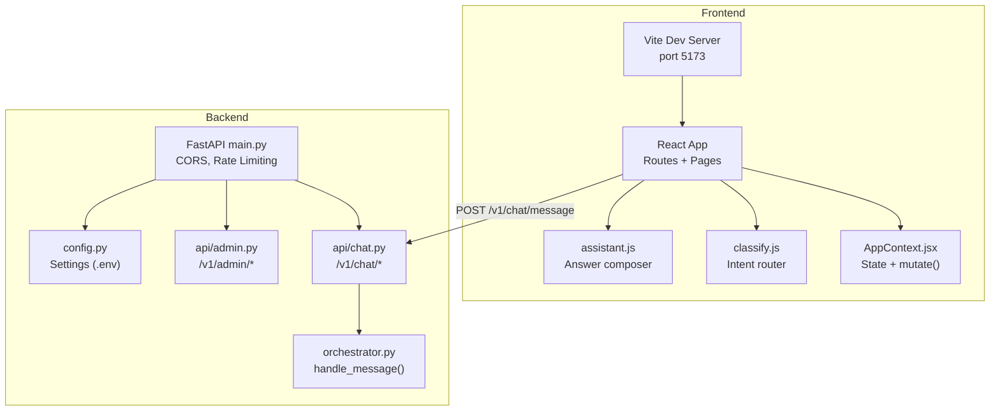
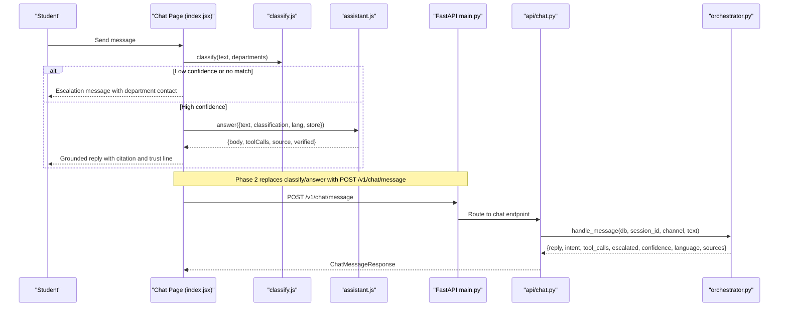
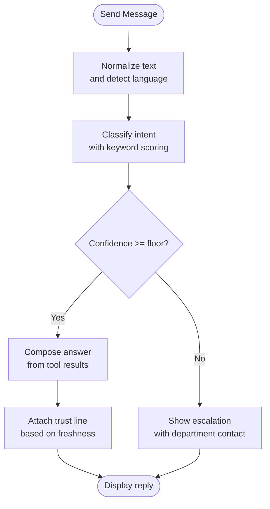
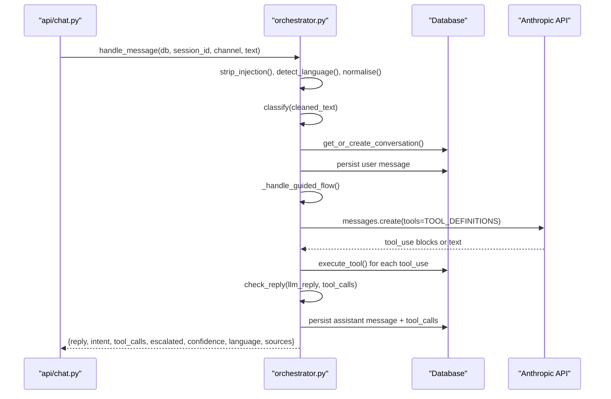
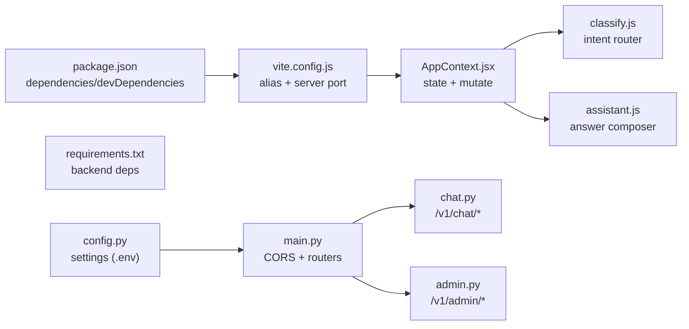

# Troubleshooting & FAQ

<cite>
**Referenced Files in This Document**
- [README.md](file://README.md)
- [package.json](file://package.json)
- [vite.config.js](file://vite.config.js)
- [AppContext.jsx](file://src/context/AppContext.jsx)
- [classify.js](file://src/lib/classify.js)
- [assistant.js](file://src/lib/assistant.js)
- [freshness.js](file://src/lib/freshness.js)
- [Chat index.jsx](file://src/pages/student/Chat/index.jsx)
- [AppShell.jsx](file://src/components/layout/AppShell.jsx)
- [main.py](file://uaea-backend/app/main.py)
- [config.py](file://uaea-backend/app/config.py)
- [chat.py](file://uaea-backend/app/api/chat.py)
- [orchestrator.py](file://uaea-backend/app/orchestrator/orchestrator.py)
- [admin.py](file://uaea-backend/app/api/admin.py)
- [requirements.txt](file://uaea-backend/requirements.txt)
</cite>

## Table of Contents
1. Introduction
2. Project Structure
3. Core Components
4. Architecture Overview
5. Detailed Component Analysis
6. Dependency Analysis
7. Performance Considerations
8. Troubleshooting Guide
9. Conclusion
10. Appendices

## Introduction
This document provides comprehensive troubleshooting and frequently asked questions for the UAEA Console, covering setup and installation issues, runtime problems with chat and intent classification, data synchronization, debugging techniques for frontend and backend, common user issues, performance optimization, memory leak detection, browser compatibility, escalation procedures, and community support resources. It is designed to be accessible to both technical and non-technical users.

## Project Structure
The project consists of a React/Vite frontend and a FastAPI backend. The frontend runs on mocks by default (Phase 1), while the backend exposes APIs for chat, admin content management, and analytics. Configuration is environment-driven, and CORS/rate limiting are configured at the application level.

**Diagram sources**
- [vite.config.js:5-12](file://vite.config.js#L5-L12)
- [AppContext.jsx:34-103](file://src/context/AppContext.jsx#L34-L103)
- [classify.js:1-270](file://src/lib/classify.js#L1-L270)
- [assistant.js:1-364](file://src/lib/assistant.js#L1-L364)
- [main.py:40-79](file://uaea-backend/app/main.py#L40-L79)
- [config.py:6-37](file://uaea-backend/app/config.py#L6-L37)
- [chat.py:21-39](file://uaea-backend/app/api/chat.py#L21-L39)
- [orchestrator.py:46-143](file://uaea-backend/app/orchestrator/orchestrator.py#L46-L143)

**Section sources**
- [README.md:11-21](file://README.md#L11-L21)
- [package.json:7-21](file://package.json#L7-L21)
- [vite.config.js:5-12](file://vite.config.js#L5-L12)

## Core Components
- Frontend state and mutations: Centralized via AppContext.jsx; all writes go through a single mutate function that currently updates local store and logs audit entries.
- Intent classification: classify.js implements deterministic keyword scoring with Roman Urdu normalization and language detection.
- Answer composition: assistant.js composes grounded replies from tool results, supports three languages, and attaches trust lines based on freshness.
- Backend orchestration: orchestrator.py processes messages end-to-end, including normalization, intent classification, guided flows, LLM tool calls, guardrails, and persistence.
- Admin API: admin.py provides authenticated endpoints for content creation and analytics.

**Section sources**
- [AppContext.jsx:24-103](file://src/context/AppContext.jsx#L24-L103)
- [classify.js:18-57](file://src/lib/classify.js#L18-L57)
- [assistant.js:128-317](file://src/lib/assistant.js#L128-L317)
- [orchestrator.py:46-143](file://uaea-backend/app/orchestrator/orchestrator.py#L46-L143)
- [admin.py:31-48](file://uaea-backend/app/api/admin.py#L31-L48)

## Architecture Overview
The chat flow integrates frontend classification and answer composition in Phase 1, while Phase 2 will route through the backend’s orchestrator. The backend enforces guardrails to prevent ungrounded claims and tracks low-confidence queries.

**Diagram sources**
- [Chat index.jsx:62-138](file://src/pages/student/Chat/index.jsx#L62-L138)
- [classify.js:195-269](file://src/lib/classify.js#L195-L269)
- [assistant.js:128-317](file://src/lib/assistant.js#L128-L317)
- [chat.py:21-39](file://uaea-backend/app/api/chat.py#L21-L39)
- [orchestrator.py:46-143](file://uaea-backend/app/orchestrator/orchestrator.py#L46-L143)

## Detailed Component Analysis

### Frontend Chat Flow and Classification
- Language detection and normalization ensure consistent scoring across English, Roman Urdu, and Urdu script.
- Confidence threshold triggers human handover when uncertain.
- Answer composer builds responses strictly from tool results and includes freshness-based trust lines.

**Diagram sources**
- [classify.js:37-57](file://src/lib/classify.js#L37-L57)
- [classify.js:195-269](file://src/lib/classify.js#L195-L269)
- [assistant.js:128-317](file://src/lib/assistant.js#L128-L317)
- [freshness.js:17-23](file://src/lib/freshness.js#L17-L23)

**Section sources**
- [Chat index.jsx:62-138](file://src/pages/student/Chat/index.jsx#L62-L138)
- [classify.js:18-57](file://src/lib/classify.js#L18-L57)
- [assistant.js:128-317](file://src/lib/assistant.js#L128-L317)
- [freshness.js:17-23](file://src/lib/freshness.js#L17-L23)

### Backend Orchestrator and Guardrails
- Normalization, language detection, and intent classification occur before conversation handling.
- Guided flows manage slot-filling and step execution.
- LLM tool calls are executed in bounded rounds; guardrails sanitize replies to remove ungrounded numbers/dates.
- Low-confidence queries are tracked for review.

**Diagram sources**
- [chat.py:21-39](file://uaea-backend/app/api/chat.py#L21-L39)
- [orchestrator.py:46-143](file://uaea-backend/app/orchestrator/orchestrator.py#L46-L143)
- [orchestrator.py:229-318](file://uaea-backend/app/orchestrator/orchestrator.py#L229-L318)

**Section sources**
- [orchestrator.py:46-143](file://uaea-backend/app/orchestrator/orchestrator.py#L46-L143)
- [orchestrator.py:229-318](file://uaea-backend/app/orchestrator/orchestrator.py#L229-L318)
- [admin.py:130-160](file://uaea-backend/app/api/admin.py#L130-L160)

### Admin API and Authentication
- Admin endpoints require an API key or bearer token validated against settings.
- Content creation endpoints log audit entries and persist changes.
- Analytics endpoints provide intent counts and unanswered query queues.

**Section sources**
- [admin.py:31-48](file://uaea-backend/app/api/admin.py#L31-L48)
- [admin.py:67-125](file://uaea-backend/app/api/admin.py#L67-L125)
- [admin.py:130-160](file://uaea-backend/app/api/admin.py#L130-L160)
- [config.py:27-32](file://uaea-backend/app/config.py#L27-L32)

## Dependency Analysis
- Frontend dependencies include React, React Router, and Vite plugin for React.
- Backend dependencies include FastAPI, Uvicorn, SQLAlchemy, asyncpg, psycopg2-binary, Alembic, Pydantic, Anthropic/OpenAI clients, pgvector, and testing libraries.
- Environment configuration drives database URLs, LLM keys, embedding provider/model, CORS origins, rate limits, and admin API key.

**Diagram sources**
- [package.json:12-21](file://package.json#L12-L21)
- [vite.config.js:5-12](file://vite.config.js#L5-L12)
- [requirements.txt:1-21](file://uaea-backend/requirements.txt#L1-L21)
- [config.py:6-37](file://uaea-backend/app/config.py#L6-L37)
- [AppContext.jsx:34-103](file://src/context/AppContext.jsx#L34-L103)
- [classify.js:1-270](file://src/lib/classify.js#L1-L270)
- [assistant.js:1-364](file://src/lib/assistant.js#L1-L364)
- [main.py:40-79](file://uaea-backend/app/main.py#L40-L79)
- [chat.py:21-39](file://uaea-backend/app/api/chat.py#L21-L39)
- [admin.py:67-125](file://uaea-backend/app/api/admin.py#L67-L125)

**Section sources**
- [package.json:12-21](file://package.json#L12-L21)
- [requirements.txt:1-21](file://uaea-backend/requirements.txt#L1-L21)
- [config.py:6-37](file://uaea-backend/app/config.py#L6-L37)

## Performance Considerations
- Frontend latency simulation: The chat page simulates processing time to make the classify → look up → answer sequence legible. In production, replace with real API calls and consider request batching and caching.
- Backend rate limiting: IP-based limiter is mounted; per-session rate limiting middleware exists for chat endpoints. Tune thresholds based on traffic patterns.
- LLM round limits: Maximum rounds capped to prevent runaway loops; monitor tool call chains and optimize tool definitions to reduce iterations.
- Freshness visualization: Use freshness buckets to prioritize reviews and avoid stale answers.

[No sources needed since this section provides general guidance]

## Troubleshooting Guide

### Setup and Installation Issues
- Node.js version conflicts
  - Symptom: Build or dev server fails due to unsupported syntax or plugin incompatibility.
  - Resolution: Ensure Node 18 or newer as documented; verify with your package manager and reinstall dependencies if necessary.
  - Section sources
    - [README.md:11-21](file://README.md#L11-L21)
    - [package.json:7-21](file://package.json#L7-L21)

- Dependency resolution issues
  - Symptom: npm install fails or produces inconsistent installs.
  - Resolution: Clean node_modules and lockfile, then reinstall; confirm peer dependencies for React and Vite plugins.
  - Section sources
    - [package.json:12-21](file://package.json#L12-L21)

- Environment configuration errors (backend)
  - Symptom: CORS errors, database connection failures, or missing API keys.
  - Resolution: Verify .env values for database_url, anthropic_api_key, embedding_api_key, cors_origins, and admin_api_key; ensure CORS allows the frontend origin (default includes localhost:5173).
  - Section sources
    - [config.py:6-37](file://uaea-backend/app/config.py#L6-L37)
    - [main.py:61-73](file://uaea-backend/app/main.py#L61-L73)

### Runtime Troubleshooting: Chat Functionality
- No response or blank reply
  - Check frontend console for errors; ensure classify returns a valid intent or fallback path is triggered.
  - Validate backend health endpoint and CORS configuration.
  - Section sources
    - [Chat index.jsx:62-138](file://src/pages/student/Chat/index.jsx#L62-L138)
    - [main.py:82-86](file://uaea-backend/app/main.py#L82-L86)

- Misrouted intents or incorrect routing card
  - Review keyword rules and Roman Urdu normalization; adjust strong/weak terms if needed.
  - Confirm department mapping and service IDs used by classifier.
  - Section sources
    - [classify.js:18-57](file://src/lib/classify.js#L18-L57)
    - [classify.js:63-190](file://src/lib/classify.js#L63-L190)

- Low confidence leading to escalation
  - Expected behavior below threshold; ensure fallback department contact is available.
  - Investigate training examples or expand rules if frequent false negatives occur.
  - Section sources
    - [classify.js:195-269](file://src/lib/classify.js#L195-L269)
    - [Chat index.jsx:80-110](file://src/pages/student/Chat/index.jsx#L80-L110)

- Unanswered or low-confidence queries not appearing in queue
  - Verify backend tracking logic and database connectivity; check admin analytics endpoint.
  - Section sources
    - [orchestrator.py:123-126](file://uaea-backend/app/orchestrator/orchestrator.py#L123-L126)
    - [admin.py:149-160](file://uaea-backend/app/api/admin.py#L149-L160)

### Data Synchronization Problems
- Changes not reflected in student-facing answers
  - In Phase 1, edits update local store via mutate(); in Phase 2, ensure mutate() is replaced with fetch calls to the backend and cache invalidation is handled.
  - Section sources
    - [AppContext.jsx:24-103](file://src/context/AppContext.jsx#L24-L103)
    - [README.md:163-191](file://README.md#L163-L191)

- Freshness indicators showing stale data
  - Confirm verified dates are updated via verifyRecord and persisted correctly; use freshness buckets to identify overdue records.
  - Section sources
    - [AppContext.jsx:105-116](file://src/context/AppContext.jsx#L105-L116)
    - [freshness.js:17-23](file://src/lib/freshness.js#L17-L23)

### Debugging Techniques
- Frontend
  - Inspect network requests and console errors; add logging around classify and answer calls to trace data flow.
  - Use browser dev tools to profile rendering and identify re-renders caused by context updates.
  - Section sources
    - [Chat index.jsx:62-138](file://src/pages/student/Chat/index.jsx#L62-L138)
    - [AppContext.jsx:34-103](file://src/context/AppContext.jsx#L34-L103)

- Backend
  - Enable logging at appropriate levels; check rate limit exceptions and CORS logs.
  - Validate database migrations and connections; test endpoints with curl or Postman.
  - Section sources
    - [main.py:18-23](file://uaea-backend/app/main.py#L18-L23)
    - [main.py:51-58](file://uaea-backend/app/main.py#L51-L58)
    - [config.py:30-32](file://uaea-backend/app/config.py#L30-L32)

### Common User Issues
- Language switching problems
  - Ensure language detection works for mixed inputs; verify greeting language selection and UI labels.
  - Section sources
    - [classify.js:46-57](file://src/lib/classify.js#L46-L57)
    - [Chat index.jsx:40-56](file://src/pages/student/Chat/index.jsx#L40-L56)

- Service lookup failures
  - Confirm service IDs and department mappings exist; validate checklist and procedure fields for targeted intents.
  - Section sources
    - [assistant.js:189-317](file://src/lib/assistant.js#L189-L317)

- Navigation difficulties
  - Verify shell layout and hotkeys; ensure command palette opens and routes render correctly.
  - Section sources
    - [AppShell.jsx:14-48](file://src/components/layout/AppShell.jsx#L14-L48)

### Performance Optimization Tips
- Reduce unnecessary re-renders by memoizing derived data and avoiding deep object clones in context updates.
- Batch API calls in Phase 2 and implement optimistic updates with rollback on failure.
- Monitor LLM round usage and tool call efficiency; refine prompts and tool definitions to minimize iterations.

[No sources needed since this section provides general guidance]

### Memory Leak Detection
- Watch for growing message arrays without cleanup; consider pagination or truncation for long sessions.
- Avoid retaining large objects in context; prefer references and selective updates.
- Profile with browser performance tools to identify leaks in event listeners or timers.

[No sources needed since this section provides general guidance]

### Browser Compatibility Issues
- Ensure modern JavaScript features supported by Node 18+ and Vite build pipeline.
- Test cross-browser rendering for RTL considerations if expanding to additional scripts beyond Urdu.

[No sources needed since this section provides general guidance]

### Escalation Procedures
- When frontend cannot resolve issues, escalate to backend team with logs, error traces, and reproduction steps.
- For persistent misclassifications, propose rule updates backed by observed query patterns and confidence metrics.
- Use admin analytics to identify high-frequency unresolved intents and prioritize improvements.

[No sources needed since this section provides general guidance]

### Community Support Resources
- Refer to project README for running instructions and architecture overview.
- Engage with maintainers via issue trackers for bugs and feature requests; share findings from analytics and queue reviews.

[No sources needed since this section provides general guidance]

## Conclusion
This troubleshooting guide addresses common setup, runtime, and user issues for the UAEA Console, with clear paths to debug frontend and backend components, optimize performance, and escalate unresolved problems. By leveraging the centralized state, deterministic classification, and guarded backend orchestration, teams can maintain accurate, trustworthy answers for students while continuously improving intent coverage and system reliability.

## Appendices

### Quick Reference: Key Endpoints and Behaviors
- Health check: GET /health
- Chat: POST /v1/chat/message
- Session retrieval: GET /v1/chat/session/{session_id}
- Escalation: POST /v1/chat/escalate
- Admin content: POST /v1/admin/content/*
- Analytics: GET /v1/admin/analytics/intents
- Queue: GET /v1/admin/queue/unanswered

**Section sources**
- [main.py:82-86](file://uaea-backend/app/main.py#L82-L86)
- [chat.py:21-115](file://uaea-backend/app/api/chat.py#L21-L115)
- [admin.py:67-160](file://uaea-backend/app/api/admin.py#L67-L160)